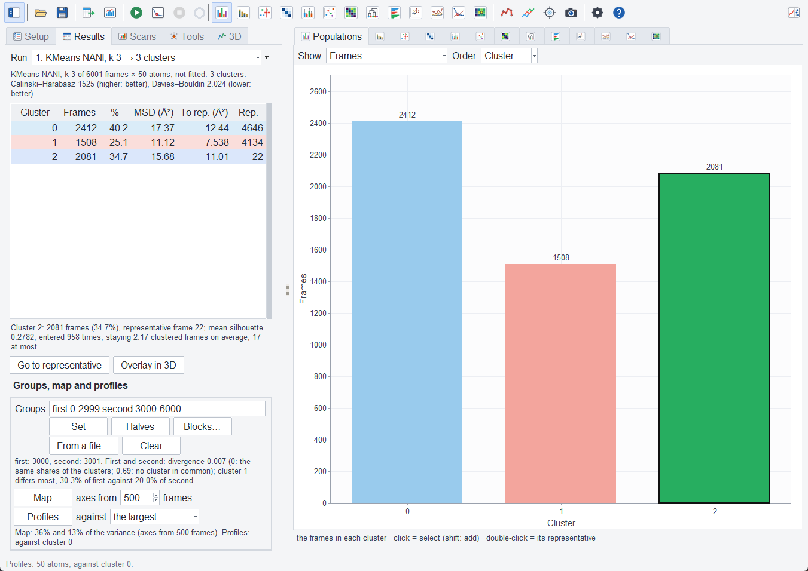

<p align="center">
  <picture>
    <source media="(prefers-color-scheme: dark)" srcset="docs/_static/logo/vmdance_dark.svg">
    
  </picture>
</p>

# VMDance — MDANCE clustering of a trajectory, in VMD

VMD and MDANCE share their MD, molecular dynamics: VMDance is the two in
one, as its logo draws it. A VMD Tcl/Tk plugin that clusters the frames of a
trajectory with the algorithms of
[MDANCE](https://github.com/mqcomplab/MDANCE) — KMeans NANI, DIVINE, HELM
and eQual, run by their C++ port
[CPP-MDANCE](https://github.com/mqcomplab/CPP-MDANCE) — and shows the
clusters: how many frames each holds, when the trajectory visits it, how it
moves between them, how tight and how far apart they are, how they join, and
their representative structures in VMD's 3D window.



## What it does

- **Clusters** a trajectory already loaded in VMD, on the atoms you choose,
  with KMeans NANI, DIVINE, HELM or eQual; every clustering is kept as a run.
- **Chooses k** with elbow scans (Calinski–Harabasz, Davies–Bouldin, the
  stability across seedings) and sweeps of algorithms, seedings and k.
- **Shows the clusters** in thirteen plots — populations, timeline,
  transitions, distances, tree, silhouette, map, profiles … — and in VMD's
  3D window, coloured by cluster, with their representatives.
- **Asks more of them**: PRIME's native-like frame, the extended similarity
  (iSIM) of each cluster, frame picks without clustering, and groups
  (replicas, halves, conditions) compared cluster by cluster.
- **Keeps the work**: sessions, tables and structures, and figures sized
  for a paper's column or a slide.
- **Scripts it all**: one command, `vmdance`, does everything the window
  does, in text-mode VMD too.

## Install

You need:

- **VMD** built with Tcl/Tk 8.6, as VMD 2 is (`info patchlevel` in VMD's
  console says which; VMD 1.9.3 and the Linux 1.9.4 alphas have Tcl 8.5).
- **CPP-MDANCE**: its program `mdance-cli`, its library `mdance_tcl`, or both.
- **Ghostscript**, for figures in PDF and PNG (optional: EPS works without it).

Build CPP-MDANCE and tell the plugin where it is:

```sh
git clone https://github.com/mqcomplab/CPP-MDANCE.git
cd CPP-MDANCE
cmake -S . -B build -DCMAKE_BUILD_TYPE=Release -DBUILD_TCL=ON && cmake --build build -j
export MDANCE_CLI=$PWD/build/cli/mdance-cli           # the program
export MDANCE_LIB=$PWD/build/tcl/mdance_tcl.so        # the library (optional)
```

Then add the plugin to `~/.vmdrc`:

```tcl
lappend auto_path /path/to/vmd-mdance-plugin/vmdance
package require vmdance   ;# adds the menu entry Analysis > VMDance
```

The plugin needs a VMD built with Tcl/Tk 8.6 and is tested in VMD 2.1
(Linux). `~/.bashrc` reaches only a VMD started from a shell: `set
env(MDANCE_CLI) /path/to/mdance-cli` in `~/.vmdrc` reaches every one, and
**Settings ▸ Backend** in the window chooses another build and keeps it.
`make distrib PLUGINDIR=…` copies the plugin into a VMD plugin tree. The
program or the library, containers, and where the backend is looked for:
[docs/install.rst](docs/install.rst).

## Getting started

Load a trajectory in VMD and open **Analysis ▸ VMDance** (in VMD 1.9:
**Extensions ▸ Analysis ▸ VMDance**), or type `vmdance` in VMD's console.
Choose the atoms in **Setup**, press **Cluster**, and read the plots. The
same from a script:

```tcl
package require vmdance
vmdance -sel "name CA" -algorithm kmeans -k 6   ;# cluster the top molecule's frames
vmdance clusters                                ;# frames, share, MSD, representative of each
vmdance help                                    ;# every subcommand
```

## Documentation

The full documentation is in [`docs/`](docs/) (Sphinx: `cd docs && make
html`, then open `docs/_build/html/index.html`):

- [Quick start](docs/quickstart.rst) and [a complete analysis](docs/tutorial.rst)
  of MDANCE's own example
- [The window](docs/window.rst), [the algorithms](docs/algorithms.rst) and
  [their parameters](docs/parameters.rst), [scans](docs/scans.rst),
  [groups](docs/groups.rst), [plots](docs/plots.rst), [files](docs/files.rst)
- [The command](docs/command.rst) and [recipes](docs/recipes.rst)
- [FAQ](docs/faq.rst), [notes and limits](docs/limits.rst),
  [design](docs/design.rst), [internals](docs/internals.rst),
  [tests](docs/tests.rst)

## Citing and licence

The algorithms are MDANCE's (the Miranda-Quintana group), run by
CPP-MDANCE (Andrey Nikitin); the host is
[VMD](https://www.ks.uiuc.edu/Research/vmd/). Cite the algorithms you use,
MDANCE and VMD: [docs/citing.rst](docs/citing.rst). VMDance © 2026 Diego
Gomes, MIT licence.
