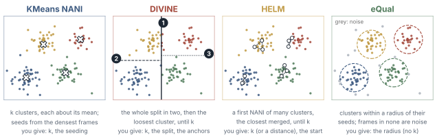

The algorithms
==============

The clustering is MDANCE's, as its C++ port CPP-MDANCE runs it. The plugin
passes the coordinates and the parameters, and reads the answer. Every
parameter, with its default and limits, is on :doc:`parameters`.

   The four algorithms on the same frames: KMeans NANI's k clusters about
   their means (✕), seeded from the densest frames; DIVINE's splits, the
   first of all the frames; HELM's many small clusters merged; eQual's
   clusters within a radius, and its noise.

.. list-table::
   :header-rows: 1
   :widths: 16 34 26 24

   * - Algorithm
     - What it does
     - You give
     - Good for
   * - KMeans NANI
     - k-means, its seeds drawn from the densest frames (or k-means++,
       random)
     - k, the seeding
     - a first look; most trajectories; the stability scan
   * - DIVINE
     - splits the frames in two, then the loosest cluster, until k
     - k, the split, the anchors, a smallest share
     - a hierarchy from the top; clusters of very different sizes
   * - HELM
     - many small NANI clusters, merged two by two until k (or a distance)
     - k or ``-eps``, the first clustering, a trim
     - a hierarchy from the bottom; the merges' heights
   * - eQual
     - clusters within a radius of their seeds; the rest noise
     - the radius (no k)
     - dense states among sparse frames; a k it finds itself

What is clustered
-----------------

Each frame is one row: the x, y, z of every atom of the selection, in the
selection's order (3 × atoms numbers). The same atoms are read at every
frame.

MDANCE expects an aligned trajectory, and the rows are clustered as they
are. The exception is *Fit to the first frame* (``-fit selection``): it
first superposes each frame on the first clustered one, by those atoms.
The fit is computed on the values, and VMD's own coordinates never move.
The fit is off unless asked.

The plugin computes the fit itself, to the last digit (Horn's quaternion).
VMD's ``measure fit`` stops after 1000 iterations and prints *Matrix:
Warning: no convergence*. Its rotation is then not always the closest one:
up to 11% above the least RMSD on the tests' fixtures, and within
0.0001 Å on MDANCE's tau peptide.

Whether the frames look superposed is measured, not assumed. A sample of
them (the first and 20 others) is compared with the first, as they are
and once fitted on it. Frames that a fit brings to half the distance, an
ångström nearer at least, do not look superposed. Setup's note under the
Fit box says so, and the command notes it as it clusters them.
``vmdance alignment`` returns the two distances. Clustered as they are,
such frames separate by where the molecule is, not by its shape.

Coordinates that are not numbers (NaN or infinite: a simulation that blew
up, a damaged file) are refused as they are read. The message names the
VMD frame and its first such atom. Leave the frame out (``-first``,
``-last``, ``-step``) or delete it. (``mdance-cli`` named a row of its
input, and the library took an infinity and answered.)

The metric
----------

``MSD``, the mean square deviation, is the metric of Cartesian
coordinates. MDANCE's extended MSD of a set of frames is the mean, over
every pair of frames (each with itself too), of their squared distance per
atom. It is twice the mean squared distance from their mean structure. For
two frames, it is half their RMSD².

The other ten indices (``BUB Fai Gle Ja JT RT RR SM SS1 SS2``) are binary
and extended similarities, meant for fingerprint-like data. Settings
unlock them in the window, and the command takes them as they are. The
exception is what uses CPP-MDANCE's diversity selection:

- the seedings ``CompSim`` and ``DivSelect`` (KMeans NANI's, HELM's first
  clustering's);
- eQual's ``comp_sim`` seeds;
- the most diverse frames (:doc:`tools`).

On coordinates, these indices fall below what the selection starts from,
and it reads past its data. ``mdance-cli`` crashed, or every frame landed
in one cluster that looked a success. MDANCE's Python stops there too. The
plugin refuses those, and says what to use instead.

- eQual takes MSD only. By the other indices, every frame is within any
  radius of the seed on coordinates, and all landed in one cluster,
  whatever the seeds.
- DIVINE takes MSD only (below).

KMeans NANI
-----------

k-means with *N-ary natural initiation*. The k seeds are chosen by
MDANCE's extended similarity:

- stratified over all the frames (``StratAll``, the default);
- stratified among the densest (``StratReduced``);
- by complementary similarity (``CompSim``);
- by diversity selection (``DivSelect``).

Or they are chosen by k-means++, or at random.

The extended-similarity seedings draw the seeds from a share of the frames
(``-percentage``, 10%). k must be at most that share of the frames: k 10
at 10% needs 100 frames. The plugin checks it and says what to raise.

The stratified seedings take the frames at evenly spaced positions of that
share. CPP-MDANCE rounds a position half away from zero, where MDANCE
(NumPy) rounds half to even. So when a position falls on a half among the
first k (50 frames at 10%: 24.5, at k 3 or more), the seeds and the
clusters differ from MDANCE's. On 3ptb's Cα, frames 0–49, k 4: 19 11 10 10
frames against 25 11 10 4. The reference suite records it.

DIVINE
------

Divisive: the whole trajectory is split in two, then the cluster chosen by
``-split`` (the largest weighted MSD, the largest MSD, the widest), until
there are k clusters. A split is a two-cluster NANI (``-anchors NANI``),
seeded by ``-kinit`` from the densest ``-percentage`` of the cluster's
frames. Or it starts from the cluster's two most distant frames
(``OutlierPair``, ``SplinterPair``).

DIVINE splits by MSD. MDANCE's DIVINE has no metric, and CPP-MDANCE's
would use another only to choose the representatives. So ``-metric`` is
MSD. Another is refused, and a sweep keeps DIVINE with another metric as
*not run*.

``-threshold`` is the smallest share of all the frames that each side of a
split keeps, at every split. It is MDANCE's minimum size of a cluster (0:
no limit). In frames, it is share × frames, cut to a whole number (0.035
of 100 frames: 3). DIVINE stops before k when no cluster can be split so,
and the summary says so. A share that no split can leave on both sides
(above 0.5) is refused.

``-end-mode points`` is the command's only: the window always stops at k.
It does not use k. The splits go on until none leaves that share on each
side, MDANCE's stopping rule. It takes a share of 2 frames or more, else
every frame ends alone. The refusal suggests 0.05, at most 20 clusters, as
CPP-MDANCE's splits slow with the square of their number. A scan does not
take it.

``-refine`` (on, MDANCE's default) refines the pair anchors' splits with a
two-cluster k-means, seeded by each side's medoid. A NANI split is a
k-means already, which ``-refine`` does not change.

CPP-MDANCE's DIVINE still crashes refining an OutlierPair split of a
cluster whose frames are all the same. MDANCE fails there too. "The same"
is as the backend reads them: frames that the fit makes alike count (a
copy turned by 90°). DIVINE comes to such a cluster only when it ranks it
first:

- with ``-split Radius``, above as many clusters as there are frames that
  differ;
- with ``MSD`` or ``WeightedMSD``, from k 3. Their rounding can rank a
  cluster of identical frames above one of frames that differ by little.
- with a share of 2 frames or more, when that many frames are the same.

k 1 and 2 never come to it: no split, or the one of every frame. The
plugin refuses the others, naming the repeated frames. ``-refine 0``,
SplinterPair, or ``-split Radius`` run them.

These are the rules of CPP-MDANCE's main since its PR #52 (1 October
2026). An older DIVINE, from a branch, gave NANI's splits no share,
rounded it, and crashed refining any pair anchors' split.

With the extended-similarity seedings (StratAll, StratReduced, CompSim,
DivSelect), a NANI split of m frames draws its two seeds from
floor(m × percentage / 100) of them. So a cluster of fewer than 200 /
percentage frames (20 at 10%) cannot be split. The plugin checks the first
split, of every frame. A later one fails the run ("DIVINE chose to split a
cluster of fewer than 20 frames …"). Then:

- raise the percentage;
- seed with KmeansPP or Random;
- or ask for fewer clusters (with ``-end-mode points``, a larger share).

With CompSim, a cluster of fewer than 100 / percentage frames crashes
CPP-MDANCE instead. The program fails that clustering, saying so. The
library would take VMD with it, so it is refused CompSim below 50% above
k 2 (k 2 is the first split alone, which the plugin checks). A scan keeps
such a k or configuration as *not run*.

The Tree plot of a DIVINE clustering is the average linkage of its
clusters' mean structures, not its splits: CPP-MDANCE does not return
them. CPP-MDANCE builds DIVINE when its tree has it (``BUILD_DIVINE``).

HELM
----

Agglomerative: HELM starts from many small clusters. They are either:

- those of a first NANI clustering (``-initial`` 50 of them, seeded
  ``StratAll``);
- or a label file's (``-initial-labels``: one label per clustered frame,
  or ``frame,label`` rows as MDANCE writes them).

It then merges:

- the pair whose union stays most compact (``Intra``, the default);
- the most similar pair (``Inter``, as MDANCE's published runs do);
- or a mix (``Half``).

It goes on until k remain (``-eps -1``), or until the closest pair is
farther than ``-eps`` (``-k 0``): one of the two.

It can first leave out the loosest starting clusters (``-trim-start 1``
with ``-trim-k``, a number, or ``-trim-val``, an MSD). It can also leave
out those smaller than ``-min-samples``.

The starting clusters are counted as the backend gets them, before HELM
runs. More than k must have frames: a first clustering can leave some
empty. With a trim, more than k must be left by ``-min-samples`` (first)
and ``-trim-k``. Else the request is refused, naming what to change, and a
scan keeps that k as not run. ``-trim-val``'s cut is an MSD the backend
computes. What it left is counted once HELM has run, and refused so too.

HELM's merges make the Tree plot: a forest when it stops at k.

eQual
-----

Extended quality: a cluster grows from a seed and takes the frames within
``-threshold`` of it. The seed is the medoid of what is left, or the
frames of highest complementary similarity. The next cluster grows from
what is left.

The radius, ``-threshold``, is MDANCE's MSD of the frame and the seed
(Ų), half their RMSD². A frame joins when its RMSD² to the seed is at
most twice the radius, so its RMSD is at most √(2 × radius): 4 Å at a
radius of 8.

There is no k: the number of clusters follows from the radius. Frames
outside every cluster are *noise* (label -1, grey everywhere). eQual never
places its last frame or two: they are noise too.

Optionally:

- small clusters are rejected as noise (``-reject-lowd``);
- the growth stops at the first cluster whose MSD is above
  ``-sim-threshold`` (``-check-sim``). This is a ceiling: that cluster and
  every frame left become noise. 0 is refused, as it makes every frame
  noise.

Which radius to try depends on the frames. ``vmdance radii`` (Setup's
*Suggest a radius*) measures the distances between about 150 of them and
proposes a range (:doc:`scans`).

What comes back
---------------

- For every frame, its cluster.
- For every cluster, its size, its representative and its MSD within. The
  representative is MDANCE's medoid, by complementary similarity: nearly
  always the frame nearest the cluster's mean structure. The MSD within is
  MDANCE's. A cluster without frames has none (CPP-MDANCE writes 0 for
  it).
- The Calinski–Harabasz and Davies–Bouldin scores of the clustered frames
  (below).
- For HELM, its merges.

The scores are computed as scikit-learn computes them:

- the Calinski–Harabasz score: between-cluster over within-cluster
  dispersion. Higher is better.
- the Davies–Bouldin score: the mean, over the clusters, of the worst
  ratio of spreads to separation. Lower is better.

There are none with fewer than two clusters, nor with every cluster a
frame alone. scikit-learn takes 2 to n − 1 clusters: CPP-MDANCE's 0, or 1
and 0, are not kept as scores. eQual's noise is left out by the backend.
HELM's trimmed frames are left out by the plugin, which scores HELM's
clustered frames itself. (CPP-MDANCE counts the trimmed frames as one more
cluster.)

The plugin checks it all before publishing:

- as many labels as frames, each a cluster or noise;
- the sizes those of the labels;
- every representative a frame of its own cluster;
- the numbers numbers (a score that is not finite is no score).

What the plugin measures
------------------------

From the same rows, once per clustering, and kept with it:

- every frame's **RMSD² from its cluster's representative** (Ų, per atom,
  no fit: twice MDANCE's MSD of the pair).
- the RMSD² between every two **representatives**, and between every two
  clusters' **mean structures** (the mean of their frames' rows).
- every frame's **silhouette** from the mean structures. a is the RMSD
  from its own cluster's mean, and b from the nearest other one. The
  silhouette is (b − a) / max(a, b), from -1 (closer to another cluster)
  to 1 (well inside its own). It is 0 for a frame alone in its cluster.

  This is the *simplified* silhouette, not scikit-learn's, which averages
  the distances to every frame of each cluster. This one reads higher:
  0.39 against 0.19 on 3ptb's Cα at k 4. The MDANCE plugin's silhouette
  squared a and b (0.62 there). For k-means it is never below 0: k-means
  puts each frame in the cluster of the nearest mean.
- every frame's **silhouette from every frame**, of the squared distances.
  a is the mean RMSD² from the other frames of its cluster. b is the
  smallest mean RMSD² from the frames of another cluster. The silhouette
  is (b − a) / max(a, b). This is the classic silhouette of the squared
  distances, and it can be below 0 for k-means too.

  It costs no more than the first. The mean squared distance from a frame
  to a cluster's frames is its squared distance from their mean structure,
  plus their own mean squared distance from it. So every pair is counted
  from the means. scikit-learn's
  ``silhouette_samples(metric="sqeuclidean")`` gives the same numbers on
  the clustered coordinates (the tests count every pair). The Silhouette
  plot shows either (*From*), ``vmdance silhouette -kind pairs`` returns
  it, and the export has both.

From the labels alone:

- the **runs** of consecutive clustered frames in one cluster (visits and
  residence);
- the **transitions** between clusters;
- each cluster's **share window by window**, and the frame it is first
  seen at (``vmdance timeline``);
- with groups, how unlike their shares of the clusters are
  (:doc:`groups`).
