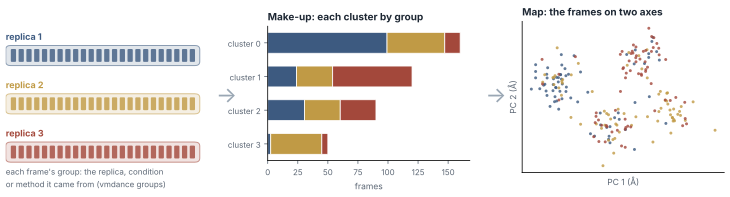
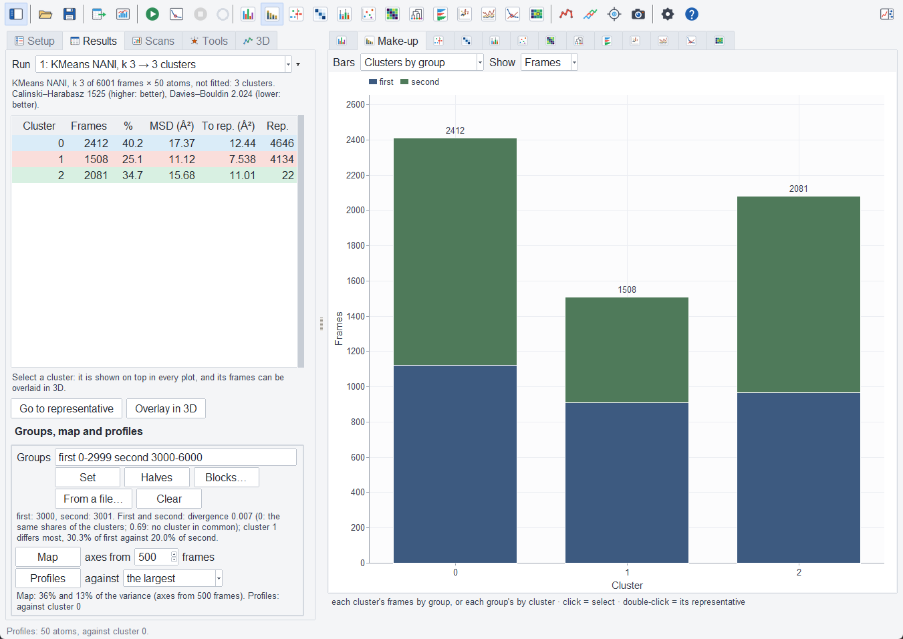
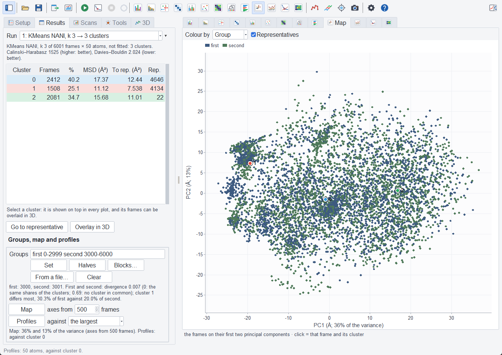
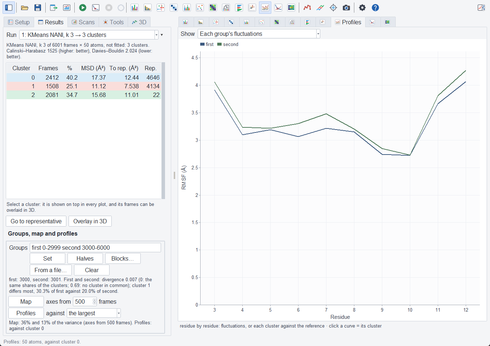

Comparing groups of frames
==========================

A trajectory is often made of parts:

- replicas run one after the other;
- conditions (a mutant, a ligand, a temperature);
- structures from several methods (MD, a structure generator, an
  enhanced-sampling run).

Give each frame the group it came from. The plugin then says how the
clusters are made of them, where each group lies, and where along the
chain they differ.

   A group per frame (left); each cluster's make-up by group (middle); the
   frames on the first two principal components, coloured by group (right).

What the groups answer
----------------------

- **Do two halves of a run, or two replicas, visit the same states?** If
  each cluster holds frames of both in similar shares, they do. A cluster
  of one group only is a state the other never reached. The two halves of
  one trajectory are the simplest test of convergence.
- **Does a condition change the ensemble?** The make-up says which states
  the condition favours, and the profiles where along the chain.
- **Do two methods sample alike?** Structures from different generators,
  clustered together, fall into clusters of mixed make-up where they
  agree, and into clusters of their own where one reaches what the other
  does not.

Setting the groups
------------------

In the window, the groups are set in **Results ▸ Groups, map and
profiles**. Type each group's name and its VMD frames,
``first 0-2999 second 3000-6000``, and press **Set** (or Return). The
other buttons:

- **Halves** makes the first and the second half of the clustered frames
  two groups, *first* and *second*.
- **Blocks…** asks for a number, and cuts the clustered frames in that
  many blocks as equal as can be (*part1*, *part2* …).
- **From a file…** reads a file of ``frame,group`` lines. It takes ``#``
  comments. A header may name the columns, so that the plugin's own groups
  export reads back.
- **Clear** takes them away.

   The Results page with the groups set, the map and the profiles made.

In a script:

.. code-block:: tcl

   vmdance groups -ranges {first 0-2999 second 3000-6000}
   vmdance groups -blocks 2                   ;# the same: the two halves (4: part1 … part4)
   vmdance groups -file groups.csv            ;# frame,group lines
   vmdance groups -names $names               ;# a name for each clustered frame
   vmdance groups -colours {first #3d5a80 second #a3483b}
   vmdance groups                             ;# names sizes none colours (none: frames of no group)
   vmdance groups compare                     ;# how unlike the groups are

A frame belongs to one group at most. A frame given none is in none. There
can be up to 256 groups, each name 1 to 64 printable characters. The
groups are kept with the run and in sessions. A new clustering of the same
frames of the same molecule takes them over.

A group's colour is the palette's (muted tones, in the order of the
groups), unless ``-colours`` names one. A name the groups do not have is
passed over. So one list colours the groups of several molecules alike,
and a protein without one of the groups keeps the others' colours.

How unlike the groups are
-------------------------

One number says whether two groups visit the clusters alike: the
Jensen–Shannon divergence of their shares of the clusters. It is 0 when
both have the same share of their frames in every cluster. It is 0.69
(ln 2) when they have no cluster in common.

The window writes it under the Groups box, for the two most different
groups, with the cluster whose share differs most between them. For the
tau peptide's two halves at k 3: *First and second: divergence 0.006 (0:
the same shares of the clusters; 0.69: no cluster in common); cluster 1
differs most, 32.1% of first against 22.3% of second*.

``vmdance groups compare`` gives every pair, and the sentence
(``words``). Each pair, as in
``pairs {{first second 0.006155 0.09841 1}}``, is:

- the two groups;
- their divergence;
- the largest difference in a cluster's share (0 to 1);
- that cluster.

Noise and frames of no group are left out, as in the make-up.

Make-up
-------

   Each cluster of the tau peptide (k 3) by the half of the trajectory its
   frames came from.

The **Make-up** plot stacks each cluster's frames by group, or each
group's frames by cluster. It shows them as counts or as shares. Each
bar's frames are written above it: as shares, every bar is as tall.

``vmdance makeup`` gives the counts (``-by cluster`` or ``-by group``).
The export gives a row per cluster and group, with both shares. Noise
(eQual's, HELM's trimmed frames) and frames of no group are left out.

Map
---

   The frames on the first two principal components (39% and 13% of the
   variance), coloured by group.

**Map** places every clustered frame on the first two principal components
of the clustered coordinates (after the clustering's fit), in Å. The axes
come from at most 500 frames spread evenly over the trajectory, and every
frame is projected on them. *Axes from* sets that number: at most 2000,
and fewer with many atoms (the map says how many).

Colour the map by group or by cluster. Both axes are drawn to one scale.
Each cluster's representative is ringed, with its number while the
clusters are 30 or fewer. The frames are drawn in a mixed order, noise
first, so that no group or cluster covers the others.

Frames close on the map have close structures. The reverse need not hold,
since two axes are a shadow of all of them. A map whose axes hold little
of the variance says little (the shares are on its axes).

Click a frame: VMD goes to it. The map is of the frames, not of their
clusters: a new clustering of the same frames and atoms (fitted the same)
keeps it.

Profiles
--------

   Residue by residue: each cluster's fluctuations about its own mean
   structure.

**Profiles** measures, atom by atom of the selection:

- each group's and each cluster's RMSF about its own mean structure;
- each cluster's mean structure's distance from the reference cluster's.

The reference is the most populated cluster, unless another is given. The
window's chooser names them: *the largest*, *cluster 0* …

The plot draws them residue by residue, with a gap between chains. Where
groups differ shows as a stretch apart from the rest: a loop that one
condition frees, a terminus one method leaves floppy.

With more than 12 clusters, the selected ones (else the 8 largest) are
drawn in colour and the others grey. Point at a curve for its name. Click
it to select its cluster.

Reading them
------------

- **Shares, not counts.** Groups of different sizes fill clusters
  differently by chance. Compare a cluster's share of each group (the
  make-up's shares *of the group*). The divergence compares those shares.
- **A cluster of one group** is the strongest signal, and the easiest to
  over-read. Check its size, its silhouette and where it lies on the map
  before calling it a state of its own.
- **The clustering is of all the frames.** The groups do not change the
  clusters. They only say where each frame came from. Cluster each group
  on its own to see each one's own states.
- **Several molecules.** Give every molecule the same names and colours
  (one ``-colours`` list), so that the figures of all of them read alike.

The tutorial uses the groups to test a run's convergence
(:doc:`tutorial`). :doc:`recipes` clusters many trajectories with the same
groups.
