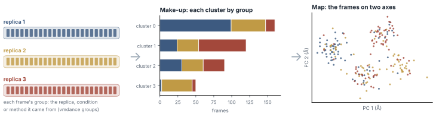
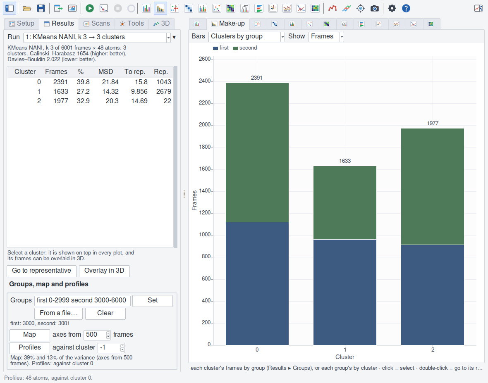
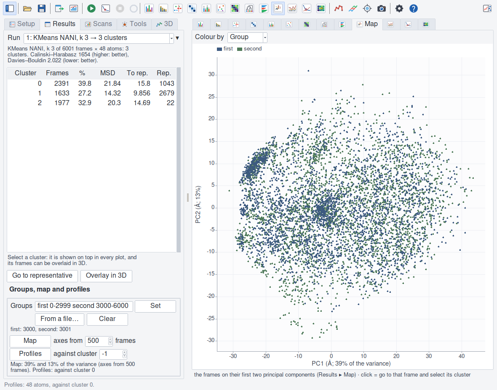
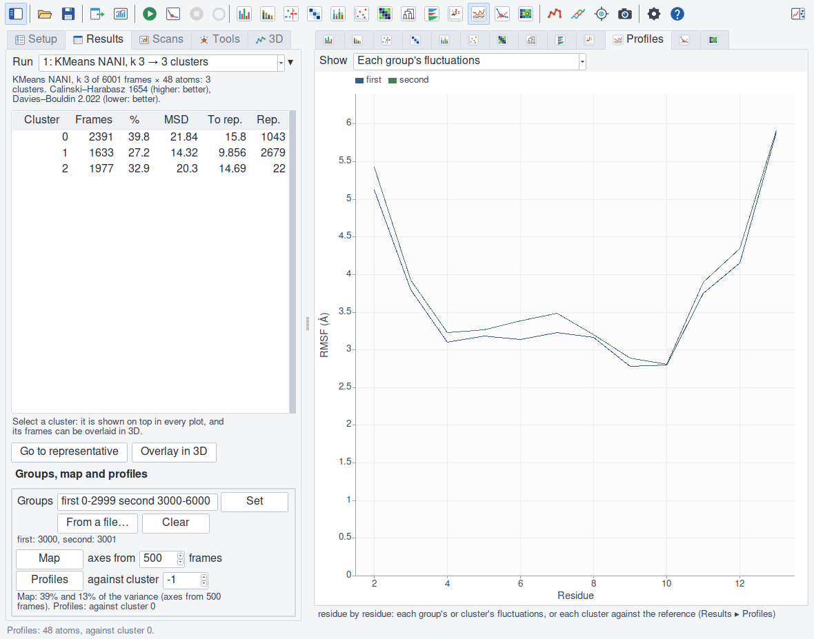

Comparing groups of frames
==========================

A trajectory is often made of parts: replicas run one after the other,
conditions (a mutant, a ligand, a temperature), or structures from several
methods (MD, a structure generator, an enhanced-sampling run). Give each
frame the group it came from, and the plugin says how the clusters are made
of them, where each group lies, and where along the chain they differ.

   A group per frame (left); each cluster's make-up by group (middle); the
   frames on the first two principal components, coloured by group (right).

What the groups answer
----------------------

- **Do two halves of a run, or two replicas, visit the same states?** If
  each cluster holds frames of both in similar shares, they do; a cluster
  of one group only is a state the other never reached. The two halves of
  one trajectory are the simplest test of convergence.
- **Does a condition change the ensemble?** The make-up says which states
  the condition favours, and the profiles where along the chain.
- **Do two methods sample alike?** Structures from different generators,
  clustered together, fall into clusters of mixed make-up where they
  agree, and into clusters of their own where one reaches what the other
  does not.

Setting the groups
------------------

In the window, **Results ▸ Groups, map and profiles**: type each group's
name and its VMD frames, ``first 0-2999 second 3000-6000``, and press
**Set** (or Return). **From a file…** reads a file of ``frame,group``
lines (``#`` comments; a header may name the columns, so that the
plugin's own groups export reads back). **Clear** takes them away.

   The Results page with the groups set, the map and the profiles made.

In a script:

.. code-block:: tcl

   vmdance groups -ranges {first 0-2999 second 3000-6000}
   vmdance groups -file groups.csv            ;# frame,group lines
   vmdance groups -names $names               ;# a name for each clustered frame
   vmdance groups -colours {first #3d5a80 second #a3483b}
   vmdance groups                             ;# names sizes none n colours

A frame belongs to one group at most; a frame given none is in none. The
groups are kept with the run and in sessions, and a new clustering of the
same frames of the same molecule takes them over. Up to 256 groups, each
name 1 to 64 printable characters. A group's colour is the palette's (muted
tones, in the order of the groups) unless ``-colours`` names one: a name
the groups do not have is passed over, so that one list colours the groups
of several molecules alike, and a protein without one of the groups keeps
the others' colours.

Make-up
-------

.. figure:: _static/figures/plot_makeup.png
   :alt: The Make-up plot: each cluster's frames stacked by group.
   :width: 100%

   Each cluster of the tau peptide (k 3) by the half of the trajectory its
   frames came from.

The **Make-up** plot stacks each cluster's frames by group; or each group's
frames by cluster; as counts or as shares. ``vmdance makeup`` gives the
counts (``-by cluster`` or ``-by group``), and the export a row per cluster
and group, with both shares. Noise (eQUAL's, HELM's trimmed frames) and
frames of no group are left out.

Map
---

   The frames on the first two principal components (39% and 13% of the
   variance), coloured by group.

**Map** places every clustered frame on the first two principal components
of the clustered coordinates (after the clustering's fit), in Å. The axes
come from at most 500 frames spread evenly over the trajectory (*axes
from*; at most 2000, and fewer with many atoms: the map says how many),
and every frame is projected on them. Colour it by group or by cluster.
Frames close on the map have close structures; the reverse need not hold,
since two axes are a shadow of all of them: a map whose axes hold little of
the variance (the shares are on its axes) says little. Click a frame: VMD
goes to it.

Profiles
--------

   Residue by residue: each cluster's fluctuations about its own mean
   structure.

**Profiles** measures, atom by atom of the selection, each group's and each
cluster's RMSF about its own mean structure, and each cluster's mean
structure's distance from the reference cluster's (the most populated,
unless another is given). The plot draws them residue by residue (a gap
between chains). Where groups differ shows as a stretch apart from the
rest: a loop that one condition frees, a terminus one method leaves
floppy.

Reading them
------------

- **Shares, not counts.** Groups of different sizes fill clusters
  differently by chance; compare a cluster's share of each group (the
  make-up's shares *of the group*).
- **A cluster of one group** is the strongest signal, and the easiest to
  over-read: check its size, its silhouette and where it lies on the map
  before calling it a state of its own.
- **The clustering is of all the frames.** The groups do not change the
  clusters; they only say where each frame came from. Cluster each group
  on its own to see each one's own states.
- **Several molecules.** Give every molecule the same names and colours
  (one ``-colours`` list), so that the figures of all of them read alike.

The tutorial uses the groups to test a run's convergence
(:doc:`tutorial`); :doc:`recipes` clusters many trajectories with the same
groups.
