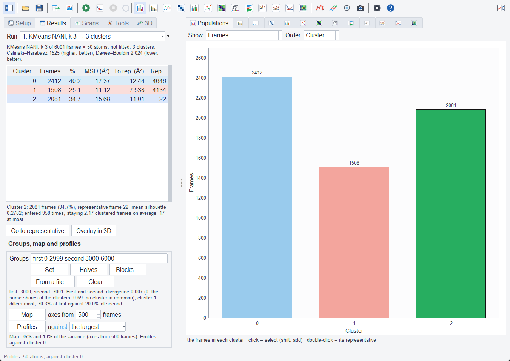
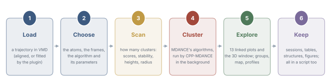

VMDance
=======

**MDANCE clustering of a trajectory, inside VMD.**

VMDance is a Tcl/Tk plugin for `VMD <https://www.ks.uiuc.edu/Research/vmd/>`_.
It clusters the frames of a trajectory with the algorithms of
`MDANCE <https://github.com/mqcomplab/MDANCE>`_: KMeans NANI, DIVINE, HELM
and eQual. Their C++ port,
`CPP-MDANCE <https://github.com/mqcomplab/CPP-MDANCE>`_, runs them.
VMDance shows the clusters in 13 linked plots, and on the structure in
VMD's 3D window.

   MDANCE's tau peptide (6001 frames; resid 3 to 12 and name CA N C O H),
   by KMeans NANI at k 3. The trajectory's two halves are the groups.

.. list-table::
   :widths: 24 76

   * - **Cluster**
     - A molecule's frames (all, a range, every n-th), by the coordinates of
       the same atoms. With KMeans NANI, DIVINE, HELM (from a first NANI
       clustering or a label file) or eQual (clusters within a radius, and
       noise). Optionally fitted to the first frame, without moving VMD's
       coordinates. A warning when the frames do not look superposed.
   * - **Choose k**
     - An elbow scan of the Calinski–Harabasz and Davies–Bouldin scores,
       ringed where they point. Davies–Bouldin's lowest value and sharpest
       dip are MDANCE's two criteria. The scan also gives the variance the
       clusters explain, and their **stability** across seedings. HELM's
       merges' heights. eQual's scan by radius, with the radii suggested
       from the frames. A sweep over algorithms, k, metrics and seedings.
       A double-click on a value of the elbow scan or the sweep makes it
       the clustering.
   * - **Explore**
     - The populations, the timeline of the clusters and their shares along
       the trajectory, their transitions and residence times. How tight and
       how far apart they are, the tree that joins them, every frame's
       silhouette (two kinds). A cluster has one hue everywhere, in the
       plots and in VMD's 3D window. Distances in Ų or Å, frames or time.
   * - **Compare groups**
     - Give each frame the half, replica, condition or method it came from.
       See each cluster's **make-up** by group, and how unlike the groups
       are. See a **map** of the frames on two principal components, and
       each group's and cluster's **profile** along the chain.
   * - **Ask**
     - PRIME's native-like frame, MDANCE's extended similarity (iSIM),
       frames picked without clustering (the most diverse, the outliers …).
   * - **Keep and share it**
     - Every clustering is kept as a run. Sessions, the MDANCE plugin's
       too. Tables with a header that says how they were made. The
       representatives' structures and each cluster's trajectory. Figures
       at the size and text size of a paper's column or a slide.
   * - **Script it**
     - One ``vmdance`` command that does all the window does, in text-mode
       VMD too.

Where to start
--------------

- New to the plugin: :doc:`install`, :doc:`quickstart`, then
  :doc:`tutorial`, a whole analysis read step by step.
- How many clusters: :doc:`scans`.
- Replicas, conditions, methods: :doc:`groups`.
- The window, pane by pane: :doc:`window`. Every plot: :doc:`plots`.
- Scripts: :doc:`command` and :doc:`recipes`.
- Files: :doc:`files`.
- Citing: :doc:`citing`.

.. toctree::
   :maxdepth: 2
   :hidden:
   :caption: Getting started

   install
   quickstart
   tutorial

.. toctree::
   :maxdepth: 2
   :hidden:
   :caption: Using it

   window
   algorithms
   parameters
   scans
   groups
   plots
   tools
   threed
   files

.. toctree::
   :maxdepth: 2
   :hidden:
   :caption: Scripting

   command
   recipes

.. toctree::
   :maxdepth: 2
   :hidden:
   :caption: Reference

   faq
   limits
   glossary
   citing
   changelog

.. toctree::
   :maxdepth: 2
   :hidden:
   :caption: Inside the plugin

   design
   internals
   tests
