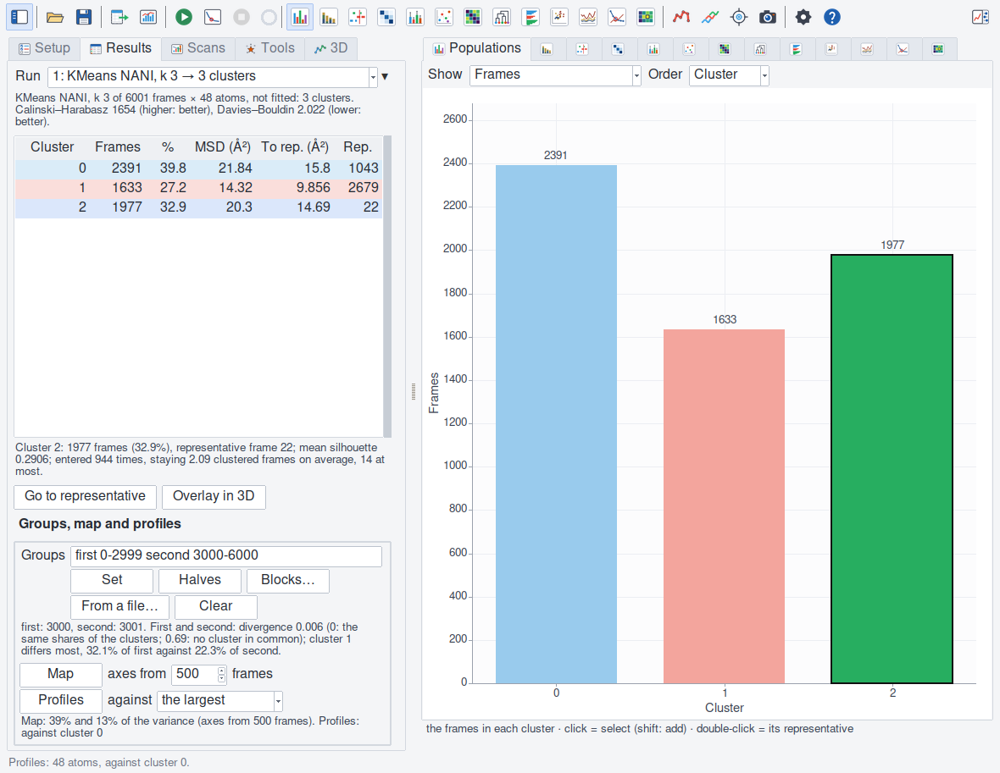
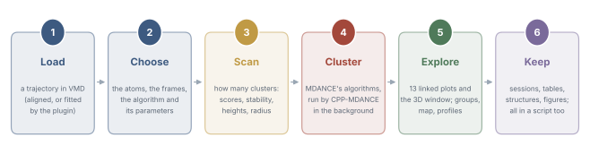

VMDance
=======

**MDANCE clustering of a trajectory, inside VMD.**

VMDance is a Tcl/Tk plugin for `VMD <https://www.ks.uiuc.edu/Research/vmd/>`_.
It clusters the frames of a trajectory with the algorithms of
`MDANCE <https://github.com/mqcomplab/MDANCE>`_ — KMeans NANI, DIVINE, HELM
and eQUAL, run by their C++ port
`CPP-MDANCE <https://github.com/mqcomplab/CPP-MDANCE>`_ — and shows the
clusters in 13 linked plots and on the structure in VMD's 3D window.

   MDANCE's tau peptide (6001 frames, the backbone): KMeans NANI at k 3;
   the trajectory's two halves as groups.

.. list-table::
   :widths: 24 76

   * - **Cluster**
     - A molecule's frames — all, a range, every n-th — by the coordinates
       of the same atoms, with KMeans NANI, DIVINE, HELM (from a first NANI
       clustering or a label file) or eQUAL (clusters within a radius, and
       noise); optionally fitted to the first frame, on the values, with a
       warning when the frames do not look superposed.
   * - **Choose k**
     - An elbow scan of the Calinski–Harabasz and Davies–Bouldin scores,
       ringed where they point (MDANCE's two criteria), with the variance
       the clusters explain and their **stability** across seedings; HELM's
       merges' heights; eQUAL's scan by radius, the radii suggested from
       the frames; a sweep over algorithms, k,
       metrics and seedings. Any of them made the clustering with a
       double-click.
   * - **Explore**
     - The populations, the timeline of the clusters and their shares along
       the trajectory, their transitions and
       residence times, how tight and how far apart they are, the tree that
       joins them, every frame's silhouette (two kinds). A cluster has one hue
       everywhere, in the plots and in VMD's 3D window. Distances in Ų or
       Å, frames or time.
   * - **Compare groups**
     - Give each frame the half, replica, condition or method it came from:
       each cluster's **make-up** by group and how unlike the groups are, a
       **map** of the frames on two
       principal components, each group's and cluster's **profile** along
       the chain.
   * - **Ask**
     - PRIME's native-like frame, MDANCE's extended similarity (iSIM),
       frames picked without clustering (the most diverse, the outliers …).
   * - **Keep and share it**
     - Every clustering kept as a run; sessions (the MDANCE plugin's too);
       tables with a header that says how they were made; the
       representatives' structures and each cluster's trajectory; figures
       at the size and text size of a paper's column or a slide.
   * - **Script it**
     - One ``vmdance`` command that does all the window does, in text-mode
       VMD too.

Where to start
--------------

- New to the plugin: :doc:`install`, :doc:`quickstart`, then
  :doc:`tutorial` — a whole analysis, read step by step.
- How many clusters: :doc:`scans`. Replicas, conditions, methods:
  :doc:`groups`.
- The window, pane by pane: :doc:`window`; every plot: :doc:`plots`.
- Scripts: :doc:`command` and :doc:`recipes`. Files: :doc:`files`.
- Coming from the MDANCE plugin: :doc:`differences`. Citing:
  :doc:`citing`.

.. toctree::
   :maxdepth: 2
   :hidden:
   :caption: Getting started

   install
   quickstart
   tutorial

.. toctree::
   :maxdepth: 2
   :hidden:
   :caption: Using it

   window
   algorithms
   parameters
   scans
   groups
   plots
   tools
   threed
   files

.. toctree::
   :maxdepth: 2
   :hidden:
   :caption: Scripting

   command
   recipes

.. toctree::
   :maxdepth: 2
   :hidden:
   :caption: Reference

   faq
   glossary
   differences
   citing
   changelog

.. toctree::
   :maxdepth: 2
   :hidden:
   :caption: Inside the plugin

   design
   internals
   tests
