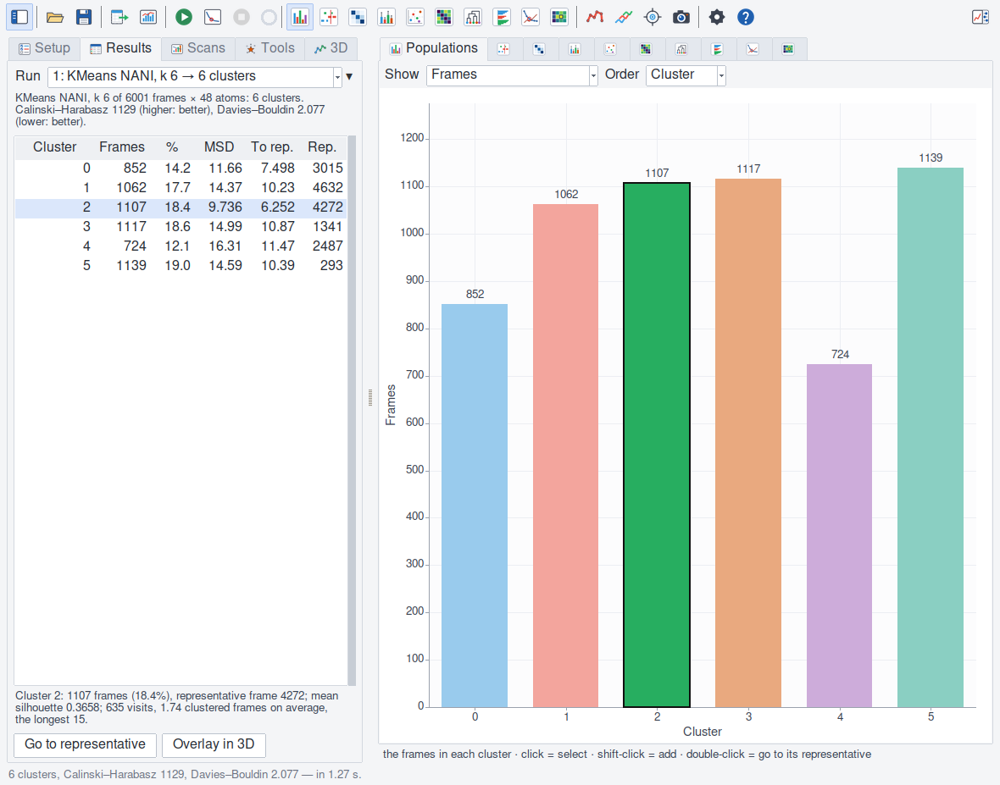
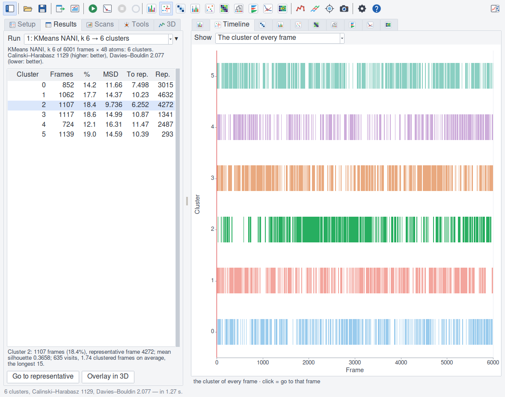
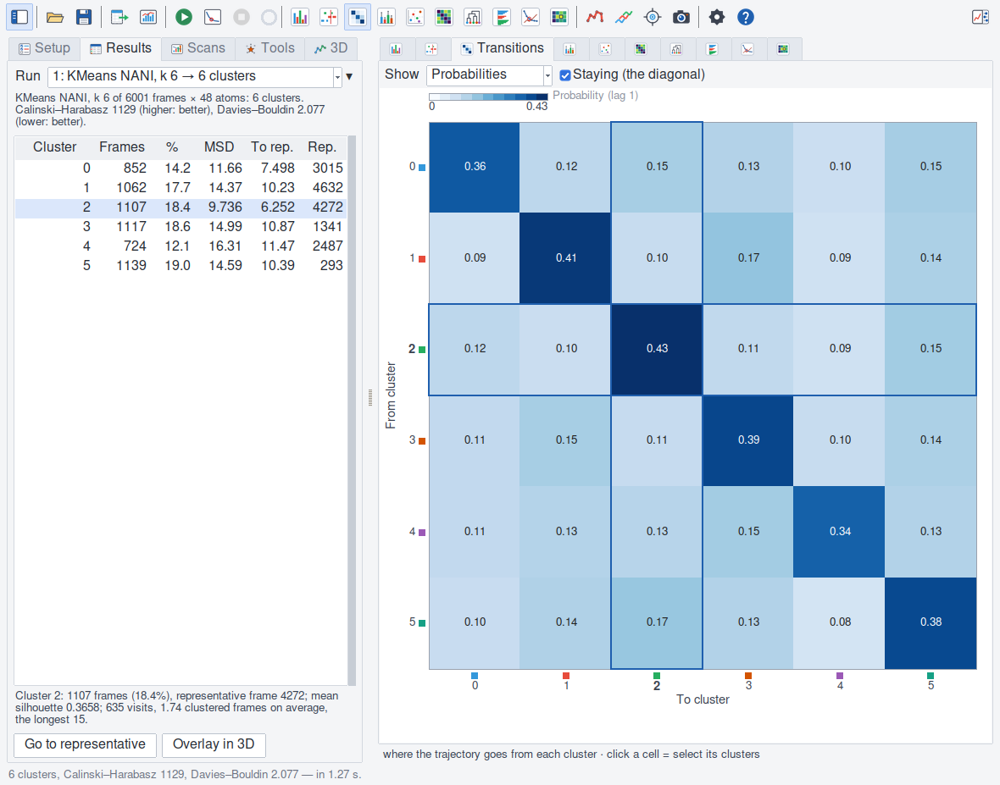
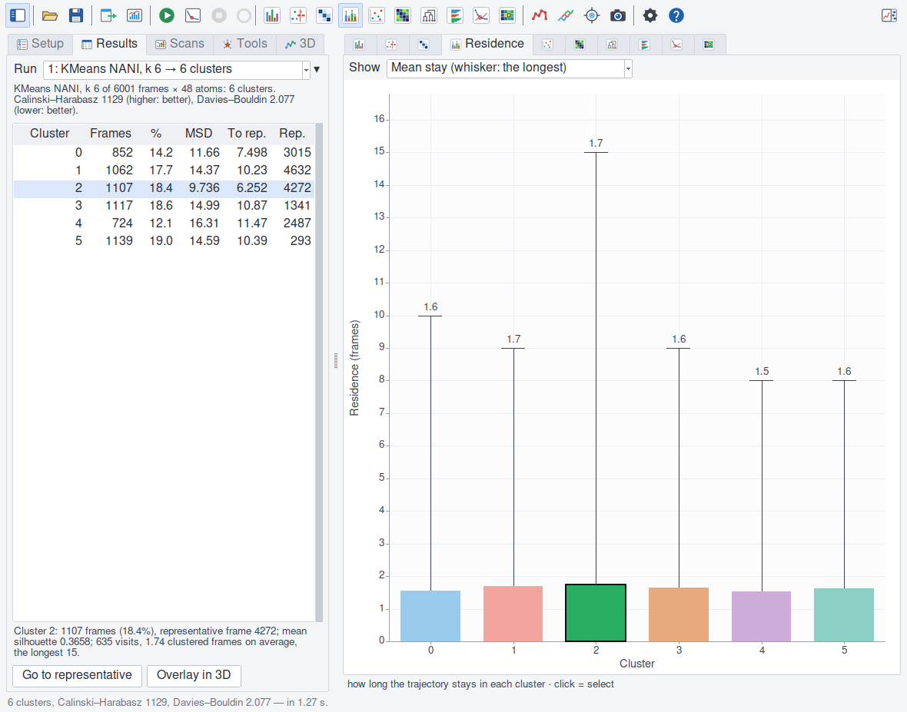
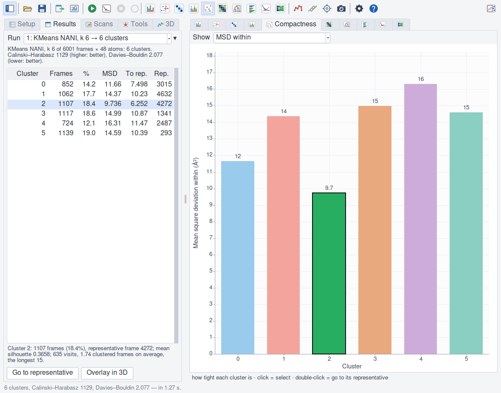
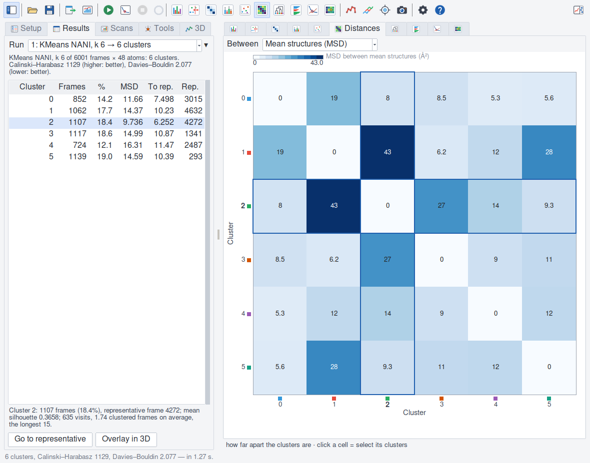
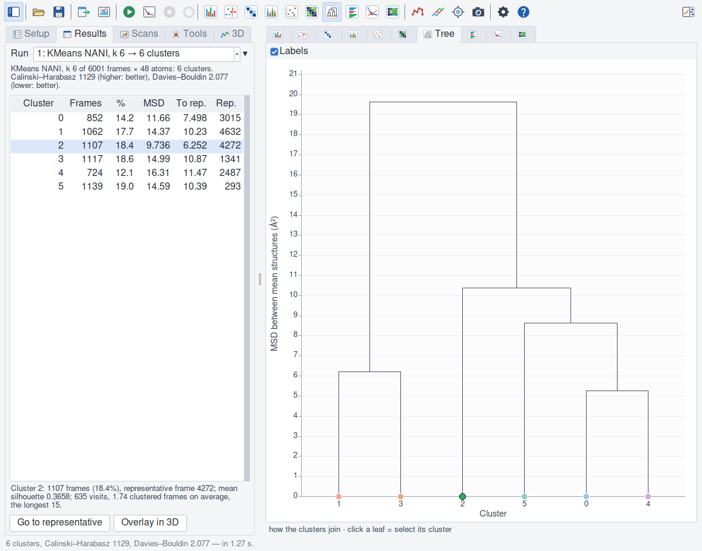
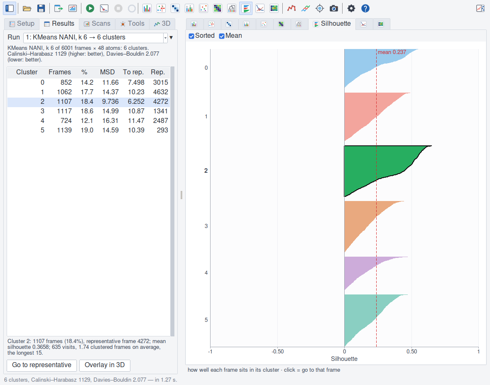
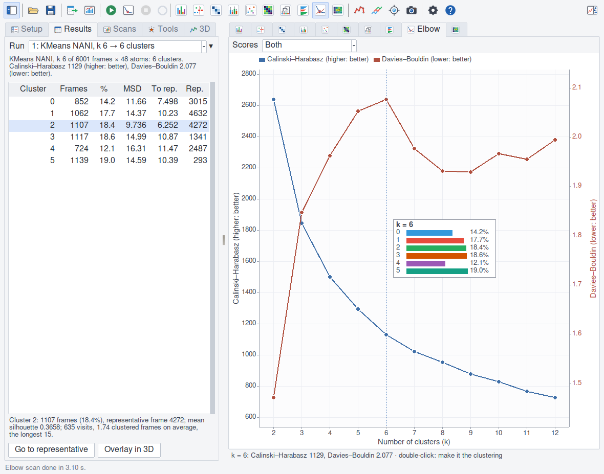
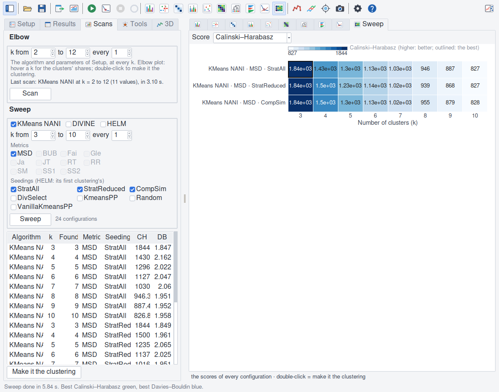

The plots
=========

Every plot draws the current clustering (the elbow and sweep plots the
last scans), the selected clusters on top and the others paler. A cluster
is drawn in a darker tone of its hue in VMD's 3D window (:doc:`threed`), or
in VMD's own colour (*Cluster colours* in the plot options); noise is grey.
Hover a plot: the line under it says what the pointer is on. The **Plot
options** panel (the toolbar's last button) holds every setting of the
current plot, and those shared by all (grid lines, legends, the line
width, the cluster colours).

Populations
-----------

The frames of each cluster, or their share of the clustered frames; in the
clusters' order or largest first; eQUAL's noise as a grey bar. Click a bar:
select the cluster (Shift: add or remove it). Double-click: go to its
representative.

Make-up
-------

Each cluster's frames by group (Results ▸ Groups: the method, replica or
condition each came from), stacked in the groups' colours; or each group's
frames by cluster. As counts, or as shares (of the cluster, or of the
group). Noise and frames of no group are left out. Click a bar: select the
cluster. Double-click: go to its representative.

Timeline
--------

A lane per cluster (noise at the bottom), with a bar wherever the
trajectory is in it; or every frame's RMSD² from its cluster's
representative, coloured by its cluster. The red line is VMD's current
frame (*Current-frame marker* in the Timeline's options). Click: go to that
frame; Shift-click: also select its cluster.

Transitions
-----------

From each cluster (rows) to the cluster of the clustered frame *lag* later
(columns): the share of the frames that go there, or their number. With
noise, a row's shares into the clusters sum to less than one: the rest went
into noise. *Staying* off leaves the diagonal out of the colours, which then
show the moves only. Click a cell: select its two clusters. The matrix is
drawn for 300 clusters or fewer (**Export** writes it for any number: above
300, when it is ticked).

Residence
---------

How long the trajectory stays in a cluster once it enters it: the mean of
its runs of consecutive clustered frames, a whisker to the longest (in
clustered frames, or VMD frames: × the step); or how many times it enters
it (visits). Click a bar: select the cluster. Double-click: go to its
representative.

Compactness
-----------

How tight each cluster is: the backend's MSD within (MDANCE's: the mean
RMSD² over every pair of its frames, each with itself too — twice the mean
squared distance from its mean structure); the mean RMSD² of its frames
from its representative (lower for the same spread: half the MSD within
plus the representative's RMSD² from the mean structure — with the metric
MSD between half the MSD within and all of it, all of it for two frames);
the MSD within against the cluster's size
(dashed: the medians — a small, loose cluster is often one of outliers,
not a state); or MDANCE's extended similarity (iSIM) of each cluster, once
**Tools ▸ Similarity** has computed it.

Distances
---------

Between every two clusters: the RMSD² between their mean structures, or the
RMSD between their representatives (no fit). Click a cell: select its two
clusters. Measured and drawn for 300 clusters or fewer (for thousands, the
2k² distances would take gigabytes).

Tree
----

How the clusters join. For HELM, its merges of its starting clusters (the
height is the merge's rank): a forest when HELM stops at k clusters, each
tree in the colour of the cluster it ends in; the starting clusters HELM
trimmed (their frames are noise) are left out, and counted in the corner.
A HELM run that merged nothing (k starting clusters) shows them as k
leaves. For the others, the average linkage (UPGMA) of the clusters' mean
structures (the height is their RMSD²), made and drawn for 300 clusters
or fewer: for DIVINE too, which is not its splits (CPP-MDANCE does not
return them), and can join its clusters across them; the axis says which
tree it is.
Click a leaf: select its cluster.

The **merges' heights** (*Show* in the Tree's options): each merge's
height against the number of clusters before it — for HELM the MSD within
the cluster it makes (MDANCE's, measured when it clustered), for the
others the average linkage's RMSD² between the mean structures it joins. A
merge much higher than the one before joins clusters far apart: the k
before it is a natural place to stop. The largest jump is circled (the
height over the one before, which counts as 5% of the highest at least:
merges of near-identical clusters are not jumps). With HELM, cluster to
fewer clusters than you mean to keep (a small k), and read the heights
back.

Silhouette
----------

Every frame's silhouette, cluster by cluster, sorted from its best to its
worst, with the mean. Frames below zero sit closer to another cluster's mean
structure than to their own's. Click: go to that frame and select its
cluster (Shift: add or remove it). With many clusters the gaps between them
shrink (a quarter of the axis at most), and the clusters' numbers are
written where they fit, the selected ones first.

Map
---

Every clustered frame on the first two principal components of the
clustered coordinates (Results ▸ Map), in Å, each axis with its share of
the variance; coloured by group, or by cluster. Frames close on the map
have close structures; the reverse need not hold (two components are a
shadow of all of them). Click a frame: go to it and select its cluster.

Profiles
--------

Atom by atom of the selection (the axis by residue, a gap between chains),
measured by Results ▸ Profiles: each group's fluctuations (RMSF about its
own mean structure, Å), each cluster's, or each cluster's mean structure's
distance from the reference cluster's (the most populated, unless another
is given). Where groups or clusters differ shows as a stretch of residues
apart from the rest. Over several atoms a residue's value is their root
mean square.

Elbow
-----

The Calinski–Harabasz and Davies–Bouldin scores at every k of the elbow
scan, each on its own axis (a cross at a k that failed or was not run; the
dashed line at the current clustering's k); with the scan's stability, a
bar at each k (0 to 1: how alike NANI's seedings cluster). An eQUAL scan
is by radius: the x axis is the radius, and the bars say how many clusters
each gave. Hover a k: its clusters' shares. Double-click: make it the
clustering.

Sweep
-----

The chosen score of every configuration of the sweep: a row per algorithm,
metric and seeding, a column per k, the best outlined (Davies–Bouldin: the
palette reversed, so that the best is the same colour). Double-click a cell:
make it the clustering.

Figures
-------

**File ▸ Create figures** (or ``vmdance figures``) draws the plots again
at a size of their own, with the text at the size figures are laid out for
(``-text``: another), and writes them as EPS, and through Ghostscript as
PDF and PNG.
