The plots
=========

Every plot draws the current clustering (the elbow and sweep plots the
last scans), the selected clusters on top and the others paler. A cluster
is drawn in a darker tone of its hue in VMD's 3D window (:doc:`threed`), or
in VMD's own colour (*Cluster colours* in the plot options); noise is grey.
Hover a plot: the line under it says what the pointer is on. A plot's tab
says its name and what it shows when the pointer rests on it. The **Plot
options** panel (the toolbar's last button) holds every setting of the
current plot, and those shared by all (*All plots*: grid lines, legends,
the line width, the distances' unit, the time per frame, the cluster
colours).

Two of the shared options change what the plots read in:

- **Distances as**: *Squared* (Ų, as they are measured: RMSD², and
  MDANCE's MSD; the default), or *Lengths* (Å: their square roots, RMSD and
  √MSD, the unit RMSD cut-offs are given in). Compactness, the Distances
  between mean structures, the Timeline's distances, the Tree's heights,
  the readouts and the table of clusters follow it; the exports keep the
  values as measured.
- **Time per frame**: the time between two frames of the molecule, with
  its unit — ``0.1 ns``, ``2 ps`` (fs, ps, ns, µs, ms or s). The Timeline
  and the Residence then read in time (*Time (ns)*, *Mean stay (ns)*), and
  a frame's readout gives its time too (*frame 50 (5 ns)*). Empty: frames.
  The Timeline's option row has the field too (*A frame:*).

There are 29 cluster colours (10 for the groups). Past them they come
again in the plots, lighter the second time, darker the third: clusters 0,
29 and 58 are not one blue (a group given a colour of its own keeps it).

Populations
-----------

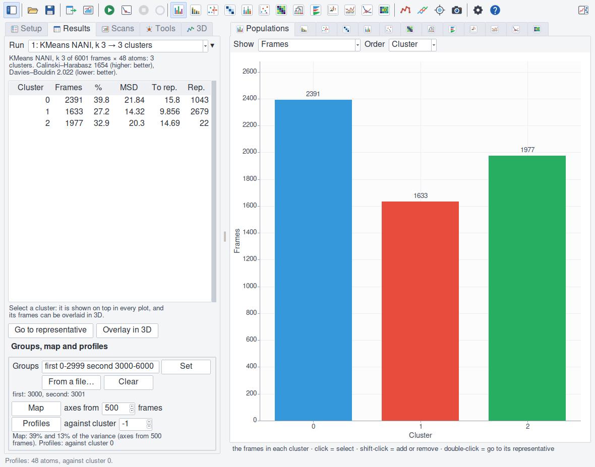

The frames of each cluster, or their share of the clustered frames; in the
clusters' order or largest first; eQUAL's noise as a grey bar. Click a bar:
select the cluster (Shift: add or remove it). Double-click: go to its
representative.

Make-up
-------

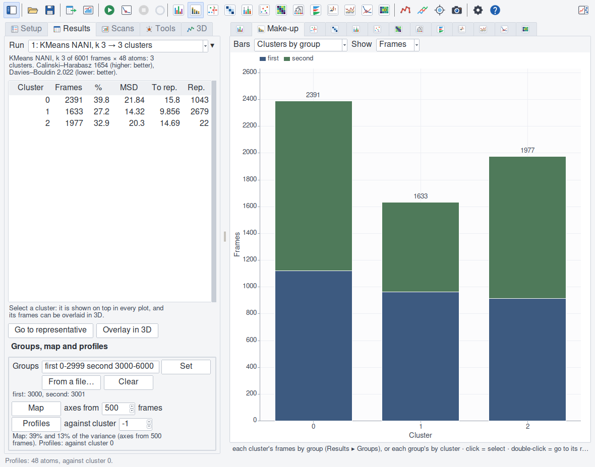

Each cluster's frames by group (Results ▸ Groups: the method, replica or
condition each came from), stacked in the groups' colours; or each group's
frames by cluster. As counts, or as shares (of the cluster, or of the
group): the shares' axis ends at 100, and each bar's frames are written
above it there too (*n = 1633*), since a bar of 16 frames is then as tall
as one of 3000. Noise and frames of no group are left out. The readout
gives the slice under the pointer first, then the bar's largest. Click a
bar: select the cluster. Double-click: go to its representative.

Timeline
--------

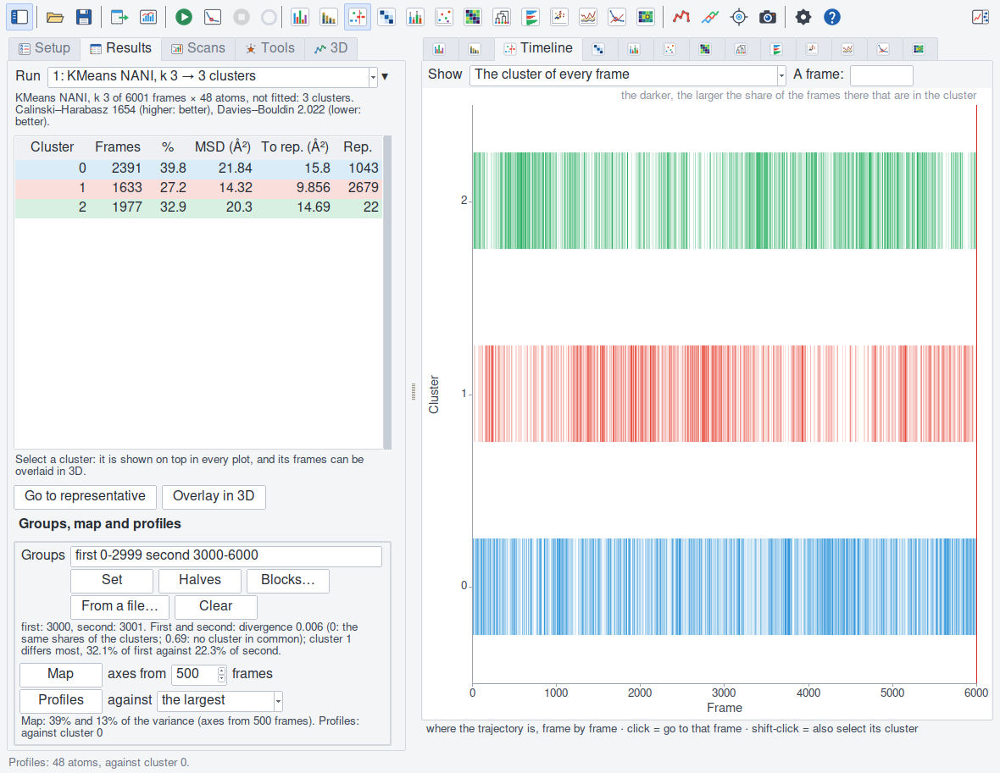

A lane per cluster (noise at the bottom), with a bar wherever the
trajectory is in it. With more frames than pixels, each pixel of a lane is
shaded by the share of the frames under it that are in the cluster (five
tones: the darker, the larger the share; a note above the lanes says so),
so that a trajectory that changes cluster every other frame does not look
as if it were in every cluster all the time. Three other views
(*Show*):

- **Each cluster's share, window by window**: the trajectory cut in
  windows as equal as can be, each a stacked bar of the clusters' shares of
  its frames (noise too). *Windows* in the plot options sets their number
  (0: about 120, of 10 frames at least).
- **Each cluster's share so far**: a line a cluster, its share of the
  frames up to each frame. Lines that have settled say that the
  populations have; a dotted line marks the frame by which every cluster
  has been seen. (With more than 40 clusters: the 40 largest, and the
  selected ones.)
- **Distance to its representative**: every frame's RMSD² from its
  cluster's representative, coloured by its cluster: a line through 400
  frames or fewer; above, a dot a frame, and the running median of the
  frames around as a line.

The red line is VMD's current
frame (*Current-frame marker* in the Timeline's options). Click: go to that
frame; Shift-click: also select its cluster. The readout says the frame
under the pointer and its cluster; where a pixel holds several frames,
those frames and how many are in each cluster; in the shares' views, the
window's frames, or the frames so far, and each cluster's share of them.
``vmdance timeline`` gives the windows' counts, and the frame each cluster
is first seen at.

Transitions
-----------

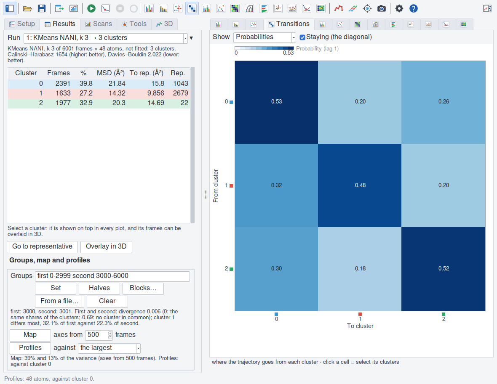

From each cluster (rows) to the cluster of the clustered frame *lag* later
(columns): the share of the frames that go there, or their number. With
noise, a row's shares into the clusters sum to less than one: the rest went
into noise, which has no column (the colour bar's title says how many
frames did). *Staying* off leaves the diagonal out of the colours, which then
show the moves only. Click a cell: select its two clusters. The matrix is
drawn for 300 clusters or fewer (**Export** writes it for any number: above
300, when it is ticked).

Residence
---------

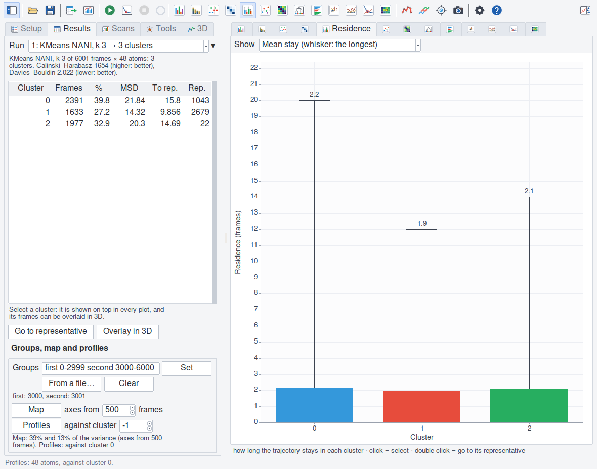

How long the trajectory stays in a cluster once it enters it: the mean of
its runs of consecutive clustered frames, with the longest written beside
it above the bar (*2.15 · longest 20*) (in clustered frames, or VMD frames:
× the step; in time, when the time per frame is given); or how many times
it enters it (visits). Click a bar: select the cluster. Double-click: go to
its representative.

Compactness
-----------

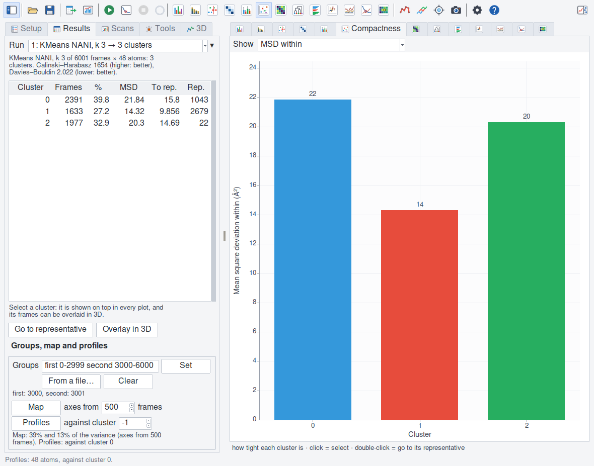

How tight each cluster is: the backend's MSD within (MDANCE's: the mean
RMSD² over every pair of its frames, each with itself too — twice the mean
squared distance from its mean structure); the mean RMSD² of its frames
from its representative (lower for the same spread: half the MSD within
plus the representative's RMSD² from the mean structure — with the metric
MSD between half the MSD within and all of it, all of it for two frames);
the MSD within against the cluster's size
(dashed: the medians — a small, loose cluster is often one of outliers,
not a state); or MDANCE's extended similarity (iSIM) of each cluster, once
**Tools ▸ Similarity** has computed it. The bars' values are written to
three significant digits. The scatter writes a cluster's number where it
has room, the selected clusters' first, and draws smaller dots above 40
clusters. With *Distances as: Lengths* the plots show √MSD and the root
mean square distance from the representative, in Å.

Distances
---------

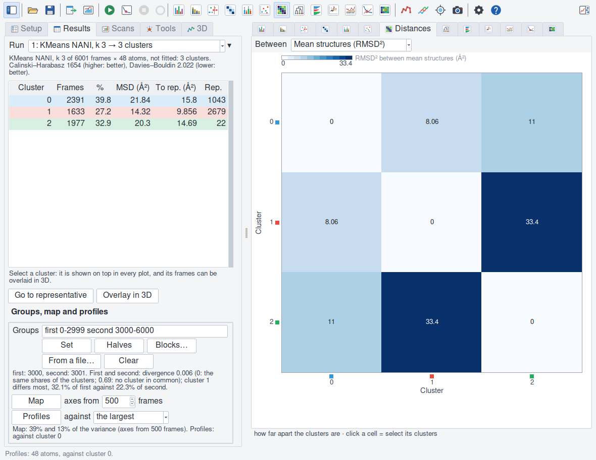

Between every two clusters: the RMSD² between their mean structures (the
RMSD, with *Distances as: Lengths*), or the
RMSD between their representatives (no fit). The cells' values are written
to three significant digits, as plain numbers. Click a cell: select its two
clusters. Measured and drawn for 300 clusters or fewer (for thousands, the
2k² distances would take gigabytes).

Tree
----

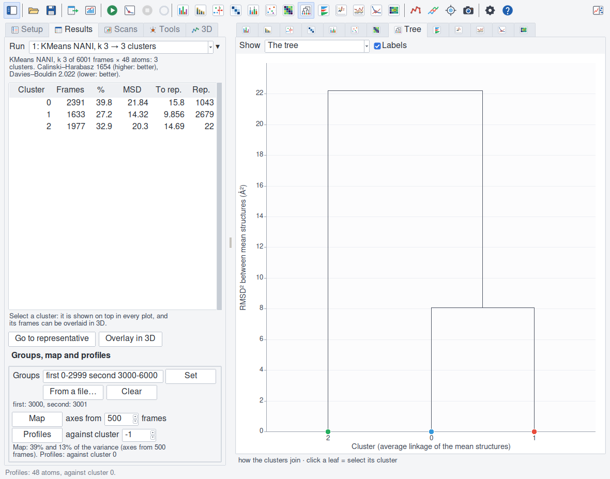

How the clusters join. For HELM, its merges of its starting clusters (the
height is the merge's rank): a forest when HELM stops at k clusters, each
tree in the colour of the cluster it ends in; the starting clusters HELM
trimmed (their frames are noise) are left out, and counted in the corner.
A HELM run that merged nothing (k starting clusters) shows them as k
leaves. For the others, the average linkage (UPGMA) of the clusters' mean
structures (the height is their RMSD²), made and drawn for 300 clusters
or fewer: for DIVINE too, which is not its splits (CPP-MDANCE does not
return them), and can join its clusters across them; the axis says which
tree it is. The leaves' labels are written side by side when they fit, and
upright, read from below, when they do not (every n-th when not even a
line's height fits between two leaves).
Click a leaf: select its cluster.

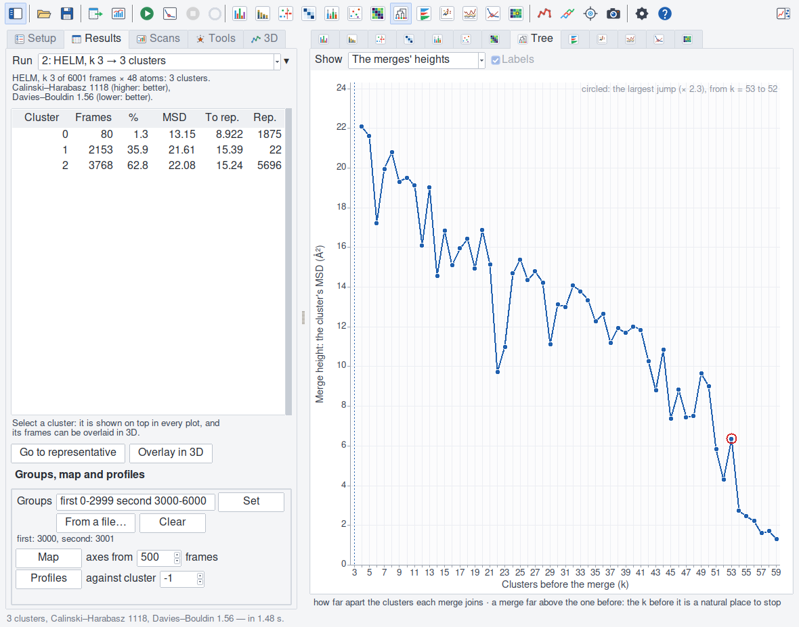

The **merges' heights** (*Show* in the Tree's options): each merge's
height against the number of clusters before it — for HELM the MSD within
the cluster it makes (MDANCE's, measured when it clustered), for the
others the average linkage's RMSD² between the mean structures it joins. A
merge much higher than the one before joins clusters far apart: the k
before it is a natural place to stop. A jump is a merge's height over the
one before (which counts as 5% of the highest at least: merges of
near-identical clusters are not jumps). The largest is circled only when
it stands out: twice the merge before at least, half as much again as the
next largest jump, and among the coarser half of the merges (among dozens
of starting clusters, two of the first merges always differ by some
factor). Otherwise a note above the plot says that no merge stands out
from the one before it. With HELM, cluster to
fewer clusters than you mean to keep (a small k), and read the heights
back. ``vmdance tree`` gives them too (``heights``), and the tree export a
column of them.

Silhouette
----------

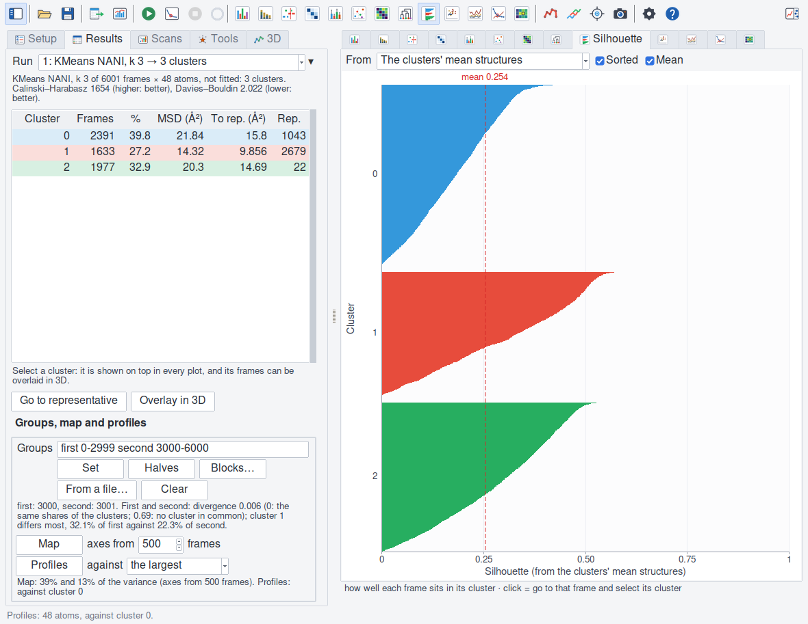

Every frame's silhouette, cluster by cluster, sorted from its best to its
worst, with the mean (written above the plot). There are two kinds
(*From*):

- **The clusters' mean structures** (the default): a is the
  frame's RMSD from its own cluster's mean structure, b from the nearest
  other one, and the silhouette (b − a) / max(a, b). This is the
  *simplified* silhouette. It is never below zero for k-means, which puts
  each frame in the cluster of the nearest mean; with the other algorithms
  a frame below zero sits closer to another cluster's mean structure than
  to its own's.
- **Every frame (squared distances)**: a is the mean squared distance
  (RMSD²) from the frame to the other frames of its cluster, b the smallest
  such mean to the frames of another cluster. This is the *classic*
  silhouette, of the squared distances: the same numbers as scikit-learn's
  ``silhouette_samples(metric="sqeuclidean")`` on the clustered
  coordinates. A frame below zero is nearer another cluster's frames than
  its own's; k-means has such frames too.

The axis starts at the lowest value (at 0 when no frame is below it), and
its title says which kind is shown. The readout gives a frame's silhouette
of both kinds. A run made before the second kind was measured has the
first only: cluster again for the other. ``vmdance silhouette -kind
centroid|pairs`` gives either, and the export's table both. Click: go to
that frame and select its
cluster (Shift: add or remove it). With many clusters the gaps between them
shrink (a quarter of the axis at most), and the clusters' numbers are
written where they fit, the selected ones first.

Map
---

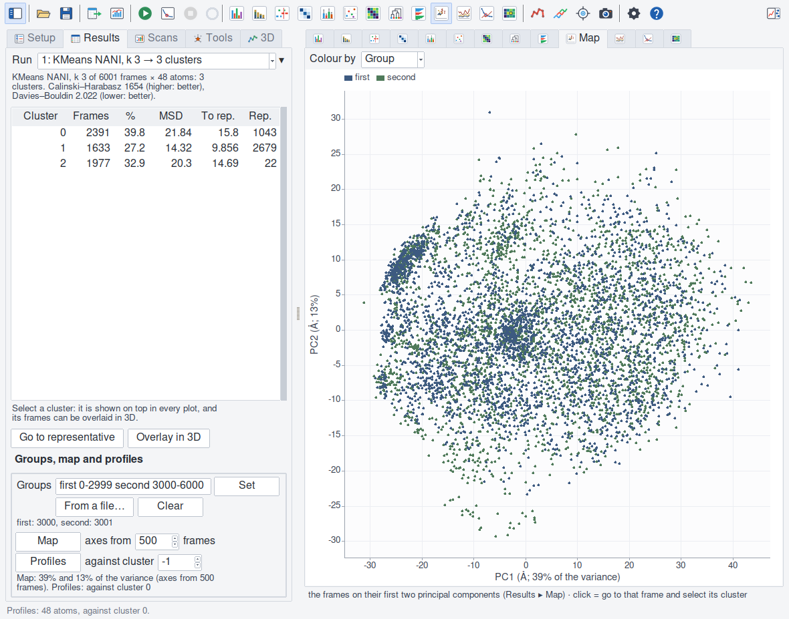

Every clustered frame on the first two principal components of the
clustered coordinates (Results ▸ Map), in Å, each axis with its share of
the variance; coloured by group, or by cluster (asked by group when the
frames have none: by cluster, and a note says so). The two components are
drawn to one scale, an ångström as long on both: a round cloud looks
round. Each cluster's representative is ringed, with its number while
there are 30 clusters or fewer (*The representatives*, in the Map's
options). The frames are drawn in a mixed order, so that no group or
cluster covers the others: noise first, the selected clusters' frames
last. The dots are as large as their number and the plot's size allow.
Frames close on the map
have close structures; the reverse need not hold (two components are a
shadow of all of them). Click a frame: go to it and select its cluster.

Profiles
--------

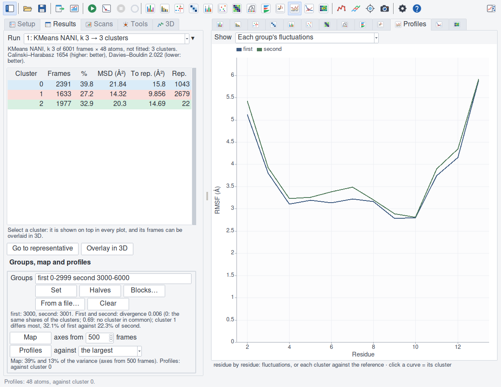

Atom by atom of the selection (the axis by residue, a gap between chains),
measured by Results ▸ Profiles: each group's fluctuations (RMSF about its
own mean structure, Å), each cluster's, or each cluster's mean structure's
distance from the reference cluster's (the most populated, unless another
is given). Where groups or clusters differ shows as a stretch of residues
apart from the rest. Over several atoms a residue's value is their root
mean square. With more than 12 clusters' curves, the selected clusters are
in colour (the 8 largest, when none is selected) and the others grey
behind them; a note above the plot says which. The readout names the curve
under the pointer, and a click on a cluster's curve selects the cluster.
The residues' ticks are at round numbers (50, 100 …).

Elbow
-----

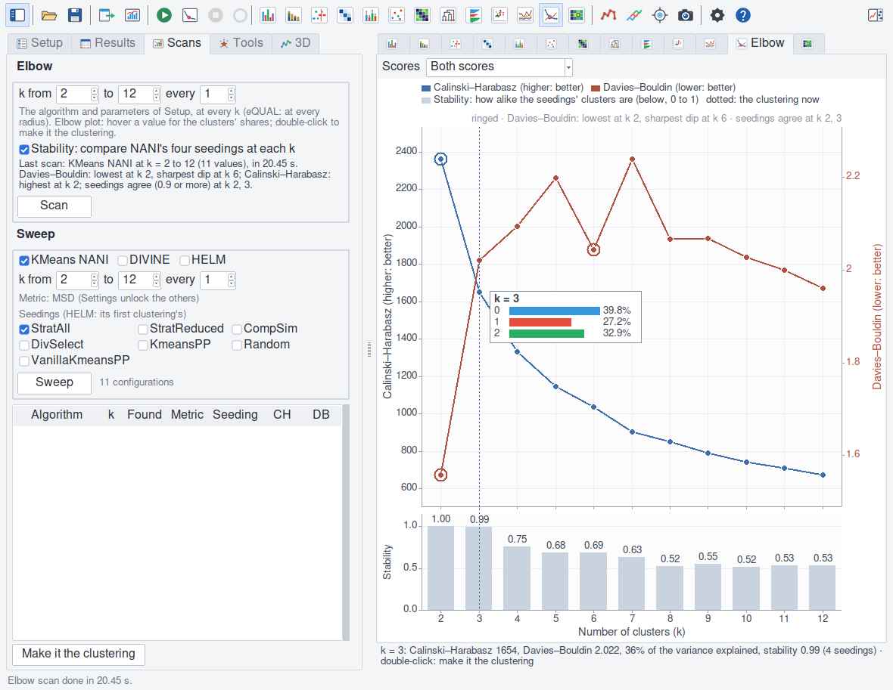

The Calinski–Harabasz and Davies–Bouldin scores at every k of the elbow
scan, each on its own axis (a cross at a k that failed or was not run; the
dotted line at the current clustering's k). *Scores* shows both, one, or a
third curve: the **variance the clusters explain**, in % — SSR/SST = CH (k
− 1) / (n − k + CH (k − 1)), from the Calinski–Harabasz score, k the
clusters with frames and n their frames. It is the curve that has an elbow
(where another cluster stops adding much), and cpptraj's SSR/SST.

Rings mark what the scan points to: on Davies–Bouldin its lowest value and
its sharpest dip (the local minimum that bends most: MDANCE's two
criteria, the lowest DB and the maximum second derivative of DB), on
Calinski–Harabasz its highest value. A line above the plot says them in
words, with the k the seedings agree on (a stability of 0.9 or more); the
Scans box says the same. The readings need not agree, and the plot does
not choose between them (:doc:`scans`).

The scan's stability is drawn in a strip of its own under the scores, with
a scale from 0 to 1: a bar at each k, its value above it (how alike NANI's
seedings cluster). An eQUAL scan
is by radius: the x axis is the radius, and the strip's bars say how many
clusters each gave. Hover a k, over the scores or the strip: its clusters'
shares, and in the readout its scores, the variance explained and its
stability. Double-click: make it the
clustering.

Sweep
-----

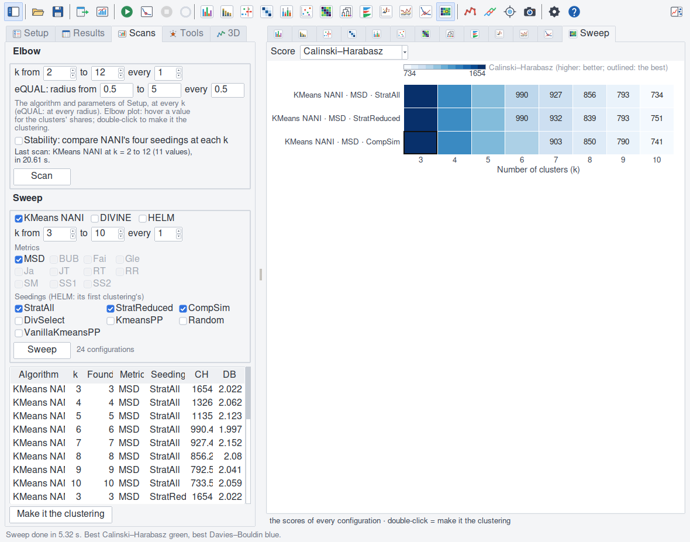

The chosen score of every configuration of the sweep: a row per algorithm,
metric and seeding, a column per k, the best outlined (Davies–Bouldin: the
palette reversed, so that the best is the same colour). Double-click a cell:
make it the clustering.

Figures
-------

**File ▸ Create figures** (or ``vmdance figures``) draws the plots again
at a size of their own, with the text at the size figures are laid out for
(``-text``: another), and writes them as EPS, and through Ghostscript as
PDF and PNG. ``-size column``, ``two-columns`` or ``slide`` sets the width,
the height and the text for a paper's column, its two columns or a slide,
and ``-width`` and ``-height`` take a unit (``85mm``): :doc:`files`. In a
figure the red line at VMD's current frame is left out unless asked
(``-cursor 1``), and the Timeline's lanes are drawn as shapes, not as an
image: sharp at any resolution. A plot that has only a message to show
(*No similarity yet*) gets no figure, and is named.
