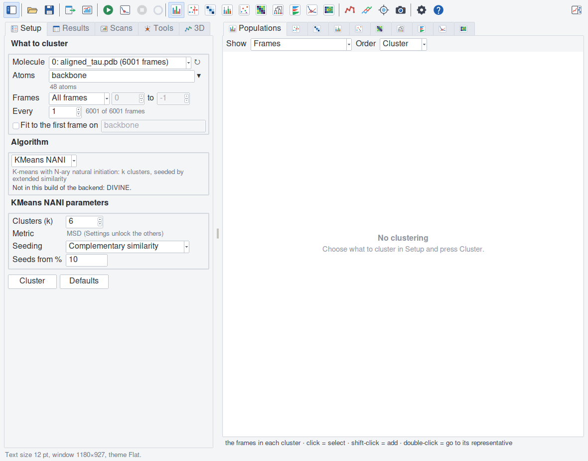

Quick start
===========

In the window
-------------

1. Load a trajectory in VMD — aligned, as MDANCE expects (or tick *Fit to
   the first frame* below).
2. Open **Extensions ▸ Analysis ▸ VMDance**.
3. **Setup ▸ What to cluster**: the molecule; the atoms (``name CA`` by
   default; the line under the field says how many); the frames and every
   n-th (the line beside says how many).
4. **Setup ▸ Algorithm**: KMeans NANI, with k 10 by default. Press
   **Cluster** (or Return in the atoms field). It runs in the background
   (with the library, VMD waits until it ends, and the line at the bottom
   says so); the ring in the toolbar shows how far it is.
5. **Results**: the table of clusters. Click a cluster: it is drawn on top
   in every plot. Double-click it: VMD goes to its representative frame.
6. The plots, on the right: **Populations**, **Timeline**, **Transitions** …
   Hover them: the line under the plot says what the pointer is on.
7. **3D ▸ Colour by cluster**, then play the trajectory: the structure takes
   the colour of the current frame's cluster.
8. Not sure of k? **Scans ▸ Elbow ▸ Scan** clusters at k 2 to 15; in the
   Elbow plot, hover a k for its clusters' shares, and double-click it to
   make it the clustering.
9. **File ▸ Save session** keeps it all; **File ▸ Export results** writes
   the tables and structures.

   The Setup tab.

In a script
-----------

.. code-block:: tcl

   package require vmdance
   # MDANCE's example (pip install mdance): mdance/data/aligned_tau.pdb, aligned_original_tau_6K.dcd
   mol new aligned_tau.pdb
   mol addfile aligned_original_tau_6K.dcd waitfor all
   animate delete beg 0 end 0     ;# the PDB's own frame: cluster the DCD's 6001
   vmdance -sel backbone -k 6 -kinit CompSim
   vmdance clusters
   vmdance elbow -sel backbone -kinit CompSim -from 2 -to 12
   vmdance elbow load 6
   vmdance export results -prefix hepta

Every question the window answers, the command answers too
(:doc:`command`), in text-mode VMD as well.
