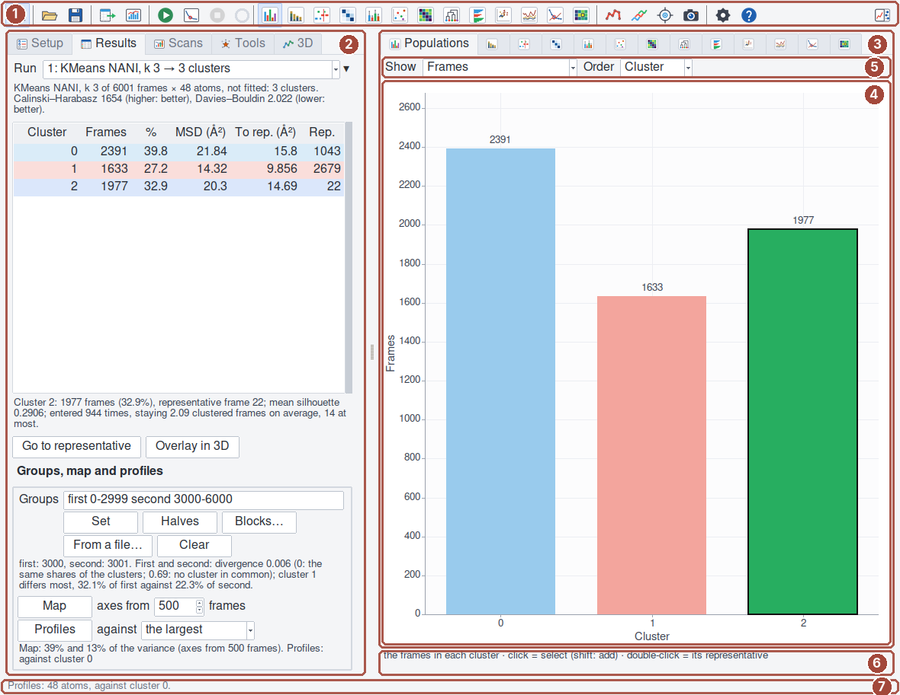
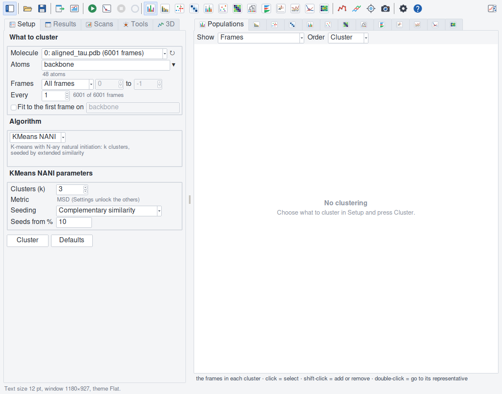

Quick start
===========

Five minutes from a trajectory to its clusters. :doc:`tutorial` goes
through a whole analysis, and says what each step means.

In the window
-------------

   (1) The toolbar; (2) the panes: Setup, Results, Scans, Tools, 3D;
   (3) the plots' tabs; (4) the plot; (5) its options; (6) what the
   pointer is on; (7) the status line.

1. Load a trajectory in VMD — superposed, as MDANCE expects (or tick *Fit
   to the first frame* below: the note under it says whether the frames
   look superposed).
2. Open **Analysis ▸ VMDance** (VMD 2; in VMD 1.9, **Extensions ▸
   Analysis ▸ VMDance**).
3. **Setup ▸ What to cluster**: the molecule; the atoms (``name CA`` by
   default; the line under the field says how many); the frames, and every
   n-th.
4. **Setup ▸ Algorithm**: KMeans NANI, with k 10 by default. Press
   **Cluster** (Ctrl+R). It runs in the background, and the ring in the
   toolbar shows how far it is (with the library, VMD waits until it ends).
5. **Results**: the table of clusters. Click a cluster: it is drawn on top
   in every plot. Double-click it: VMD goes to its representative frame.
6. **The plots**, on the right: Populations, Timeline, Transitions … Hover
   them: the line under the plot says what the pointer is on.
7. **3D ▸ Colour by cluster**, then play the trajectory: the structure
   takes the colour of the current frame's cluster.
8. Not sure of k? **Scans ▸ Elbow ▸ Scan**, with *Stability* ticked:
   the scores at every k, ringed where they point, and whether the
   clusters depend on the seeding. The readings need not agree
   (:doc:`tutorial`). Double-click a k to make it the clustering
   (:doc:`scans`).
9. Where did each frame come from? **Results ▸ Groups**: **Halves** for the
   two halves of the run, or name the replicas
   or conditions by their frames (``first 0-2999 second 3000-6000``), and
   read the **Make-up** plot and the line under the box, which says how
   unlike the groups are (:doc:`groups`).
10. **File ▸ Save session** keeps it all; **File ▸ Export results** writes
    the tables and structures; **File ▸ Create figures** the plots.

   The Setup pane.

In a script
-----------

.. code-block:: tcl

   package require vmdance
   # MDANCE's example (pip install mdance): mdance/data/aligned_tau.pdb, aligned_original_tau_6K.dcd
   set m [mol new aligned_tau.pdb]
   mol addfile aligned_original_tau_6K.dcd waitfor all
   animate delete beg 0 end 0 $m     ;# the PDB's own frame: cluster the DCD's 6001
   vmdance elbow -mol $m -sel backbone -kinit CompSim -from 2 -to 12 -stability 1
   vmdance elbow suggest             ;# where the scores point, and the k the seedings agree on
   vmdance elbow load 3              ;# the stable k: the clustering
   vmdance clusters
   vmdance export results -prefix tau

Every question the window answers, the command answers too
(:doc:`command`; ``vmdance help`` lists its subcommands), in text-mode VMD
as well (``vmd -dispdev text``).
