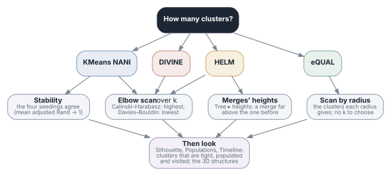

How many clusters? Scans
========================

Most clusterings are given their number of clusters, and the number is
the choice that matters most. A scan answers it by clustering the same
frames many times: at every k (the **elbow**), at every radius (eQUAL), or
over algorithms, metrics and seedings (the **sweep**). Three views beside
the scores help where the scores alone do not decide: the **stability** of
the clusters across seedings, HELM's **merges' heights**, and eQUAL's
**radius**.

:doc:`tutorial` reads all of them on one trajectory.

A scan clusters the same frames many times, and keeps every clustering: its
scores and its clusters' sizes in the table and the plots, its labels to
make it the clustering later (measured then). The coordinates are read once
for the whole scan (twice more for HELM's scores with a trim, every k's
together; the library is given one list of them for every clustering, made
once). A value that its parameters cannot take (NANI's seeds
at a larger k, HELM's starting clusters: counted after its first
clustering, and its trim, ``-trim-val``'s once HELM has run; with the
library, DIVINE seeded by CompSim below 50% above k 2, which would take VMD
with it) is kept as *not run*, with the reason, and the scan goes on (a
scan where none can run is refused, and the one there was is kept); a
clustering that fails is kept as *failed*,
with the backend's message (a crash of ``mdance-cli`` too). ``mdance-cli``
ended from outside (Ctrl+C at VMD's terminal, ``kill``) stops the scan, as
Cancel does, and the scan that was there is kept. In the window, an elbow
scan cancelled after two values or more keeps them as the scan, and the
line at the bottom says which (not HELM's: its values are scored together
once all are made).

Elbow
-----

The Setup's algorithm and parameters at every k of a range. From the
command a scan takes its own options, as a clustering does: one not given
is the command's default (Cα, KMeans NANI seeded ``StratAll``), not the
current run's — ``vmdance elbow -sel backbone -kinit CompSim -from 2 -to
15 -by 1`` (or ``-ks {…}``) follows a backbone clustering seeded by
CompSim; the scan says what it reads, and notes when that is not what the
current run clustered. HELM starts from the same clusters at every k (its
first NANI clustering is made once); a record's number of clusters counts
those with frames. In the window's Scans box the k row is shown for the
algorithms that take a k, and the radius row for eQUAL; *Stability* is
KMeans NANI's only. The Elbow
plot shows the two scores; a peak of Calinski–Harabasz, or a low point of
Davies–Bouldin, suggests a k. Hover a k for its clusters' shares — a k at
which one cluster takes nearly everything, or several hold a few frames, is
seldom the one. ``vmdance elbow load 6`` (or a double-click) makes that
k the clustering.

**What the scan points to.** The Elbow plot rings the values the scores
point to; a line of words above it, the Scans box and ``vmdance elbow
suggest`` say them:

- **Davies–Bouldin's lowest value**, and **its sharpest dip**: the local
  minimum that bends most (the second difference, the score before plus
  the score after less twice its own, is largest). These are MDANCE's two
  criteria: the lowest DB, and the maximum second derivative of DB.
- **Calinski–Harabasz's highest value.**
- **The values the seedings agree on**: a stability of 0.9 or more, when
  the scan measured it.

``elbow suggest`` returns them (``db_lowest db_second db_dip db_dip2
ch_highest ch_peak stable most_stable``, each a k, or a radius of an eQUAL
scan; empty where the scan does not say) and the sentence (``words``). The
readings need not agree, and the plugin does not choose: on MDANCE's tau
peptide Davies–Bouldin is lowest at k 2 and dips most at k 6, and the
seedings agree only at k 2 and 3 (:doc:`tutorial` says what each means).

A third curve, *Scores ▸ Variance explained* in the Elbow plot, is the
share of the frames' variance that the clusters explain: SSR/SST = CH (k −
1) / (n − k + CH (k − 1)), from the Calinski–Harabasz score. It rises
with k; where it bends, another cluster stops adding much. This is the
curve with an elbow, and cpptraj's SSR/SST.

Choosing k is seldom settled by the two scores: on structures that are not
in well-separated states, Davies–Bouldin falls as k grows, to the end of
the range, and Calinski–Harabasz favours the smallest k. Three more views:

- **Stability** (``vmdance elbow … -stability 1``; k-means NANI): every k
  clustered again from the four seedings that draw no random number
  (StratAll, StratReduced, CompSim, DivSelect), and the mean adjusted Rand
  index of every two (1: the same clusters whatever the seeding). A k whose
  clusters do not depend on the seeding describes the frames, not the
  seeds; a scan that is never stable (below about 0.5 at every k) says that
  the frames hold no clusters k-means finds at those k. The scan takes four
  times as long; the Elbow plot draws it as bars in a strip under the
  scores, on a scale from 0 to 1, and the scan's records and its export
  have it as a column. A stable k is reproducible; that alone does not
  make it the right one.
- **The merges' heights**: HELM merges its starting clusters two by two,
  and the MSD within the cluster each merge makes is its height (the Tree
  plot's *merges' heights*; for the other algorithms, the average linkage of
  their clusters); the number of clusters before a jump in height is a k to
  try (``vmdance tree`` gives them: ``heights``). The plot circles a jump
  only when it stands out — twice the merge before, half as much again as
  the next largest jump, among the coarser half of the merges — and says
  so when none does (:doc:`plots`).
- **eQUAL's radius**: eQUAL is given no k but a radius, and finds as many
  clusters as that radius makes; ``vmdance elbow -algorithm equal -radii
  {0.5 1 2 4}`` (or the Scans tab's range of radii) scans it, and the
  number of clusters each radius gives (a plateau over several radii: a k
  the frames hold) stands beside the scores, in the strip under them. The
  radius is MDANCE's MSD (Ų), half the RMSD² of a frame and its seed: a
  frame joins a cluster within √(2 × radius) Å of RMSD, which Setup writes
  under the field. Which radii to try depends on the frames: **Suggest**
  (in the Scans box; *Suggest a radius* in Setup; ``vmdance radii``)
  measures the distances between about 150 frames, evenly taken, and
  proposes a range, from the distance the nearest 2% of their pairs are
  within to the one half of them are, in ten steps. Setup's Radius, when
  empty, gets the distance a tenth of the pairs are within.

Sweep
-----

Every combination of algorithms (KMeans NANI, DIVINE, HELM), values of k,
metrics and seedings, in that order: ``vmdance sweep -algorithms {kmeans
helm} -from 2 -to 10 -metrics MSD -seedings {StratAll CompSim}`` (DIVINE
with a metric other than MSD is kept as *not run*: it splits by MSD; and
neither scan takes its ``-end-mode points``, which does not use k). The
other parameters are the Setup's (``-params {kmeans {percentage 20}}`` in a
script, where a seeding is refused: it is ``-seedings``), and the input the
options given (as the elbow's). HELM's seeding is its first clustering's;
HELM from a label file (no first clustering) and DIVINE with pair anchors
(no NANI) use none, and are run once at each k, their seeding *none*.
The table marks the best Calinski–Harabasz (green) and the best
Davies–Bouldin (blue): a failed configuration, or one without scores (one
cluster, or every cluster a frame alone), is never best, and of equal
scores the first wins.
``vmdance sweep best db`` names it; ``sweep load n`` (or a double-click)
makes a configuration the clustering. More than 50 configurations are
confirmed first; Cancel stops the sweep between clusterings or during one
(with the library, VMD waits for each, and Cancel acts when it ends).
