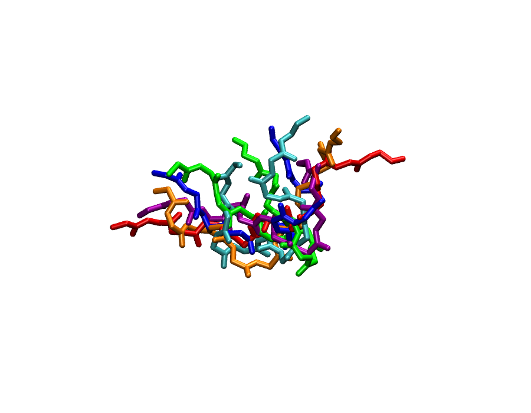

3D
==

Every drawing is a representation of the plugin's own, added to the
clustered molecule (the picked frames: to theirs) and found again by its
name: the plugin never changes or deletes another representation, and never
writes the molecule's data unless asked. The settings VMD's ``mol addrep``
takes are read and put back.

A drawing is made only on a molecule that has the frames it draws, at their
numbers (frames added after them change nothing). When frames are deleted
before them, or a trajectory is loaded otherwise, it is withdrawn — at the
next change of VMD's frame (VMD says nothing of a deletion), as a figure is
rendered, or as the window sees the molecules change — and the 3D tab, and
``draw``'s ``note``, say why; it comes back with a clustering of the frames
as they are.

- **Colour by cluster**: the atoms in the colour of the cluster of VMD's
  current frame (of the clustered frame at or before it); it follows the
  trajectory as it plays, or as a movie is made. Noise, and frames outside
  the clustered ones, are grey.
- **Every cluster's representative**: one representation per cluster,
  drawn at its representative frame, in its colour — the clusters' typical
  structures, superposed as the trajectory has them.
- **Overlay**: the selected clusters' frames nearest their representative
  (at most *n*; the first is the representative), or frames typed as
  ``0-100,500,900-1000``, each in its cluster's colour (typing them chooses
  them; Return, or leaving the field, draws them; chosen with none typed,
  no overlay is drawn).
- **The picked frames** (Tools), in orange, on their own molecule, with or
  without a clustering.

*Style* (NewCartoon, Licorice, Lines, Tube, Trace, CPK, VDW), *Atoms* (the
residues of the clustered atoms when empty; checked as typed, on the
clustered molecule, else the top one; one that selects nothing on the
molecule drawn is drawn as empty, and said) and *Material* apply to all.
**Go to representative** moves VMD's frame there.

In the 3D window a cluster has VMD's colour of an id — clusters 0, 1, 2,
3, 4, 5 … are blue, red, green, orange, purple, cyan … (the ids 0, 1, 7, 3,
11, 10 …; never grey, silver, white or black) — and in the plots a darker
tone of the same hue (#3498db, #e74c3c, #27ae60, #d35400, #9b59b6,
#16a085 …: InteractionView's), since the plugin does not change VMD's
colours. *Cluster colours ▸ VMD's* in the plot options draws the plots, the
table and the key in VMD's colours, read from VMD as they are drawn (VMD
tells no one of **Graphics ▸ Colors**: they follow it when the window has
the focus again). The key lists the plots' tone and the VMD colour of each
cluster.

**Write the clusters to the user field** (``vmdance userfield``) puts
every clustered frame's cluster in the atoms' user field (-1: noise and the
frames that were not clustered), for any representation coloured by
*User*: the one thing that changes the molecule's data, asked for.

``vmdance draw`` does all of it in a script: ``-colour -reps -overlay
-picks`` (0 or 1), ``-style -sel -top -frames -material``.
