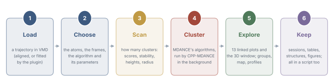
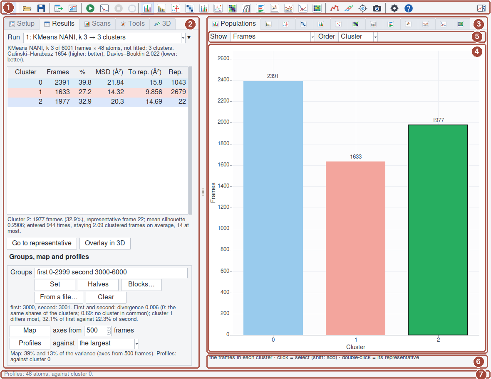
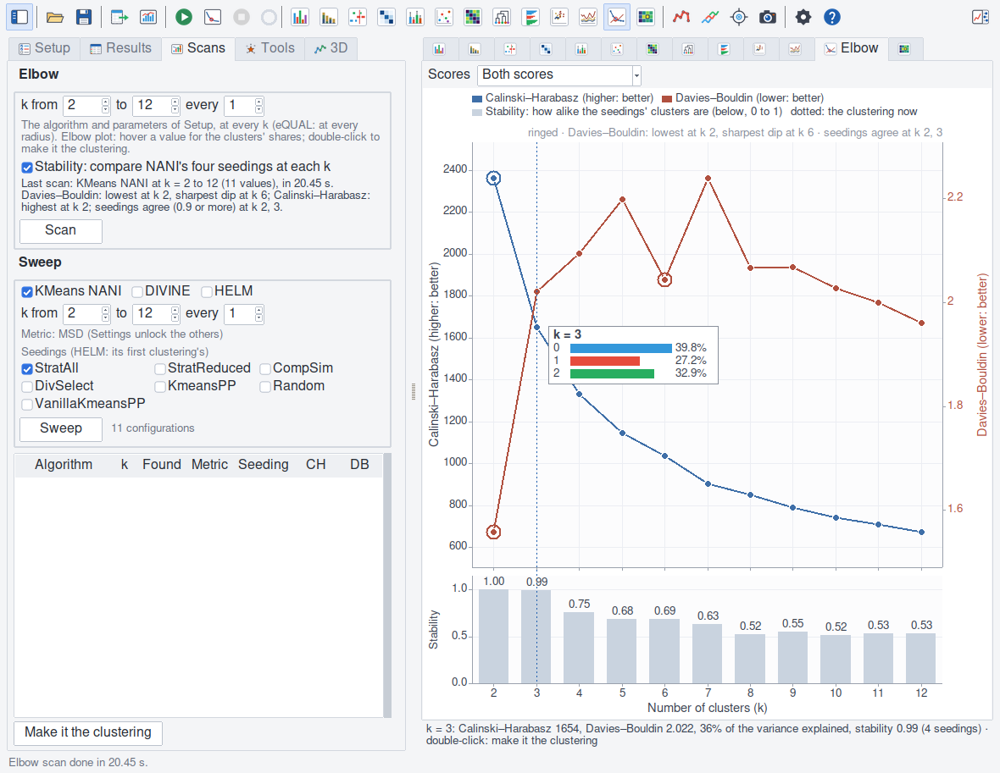
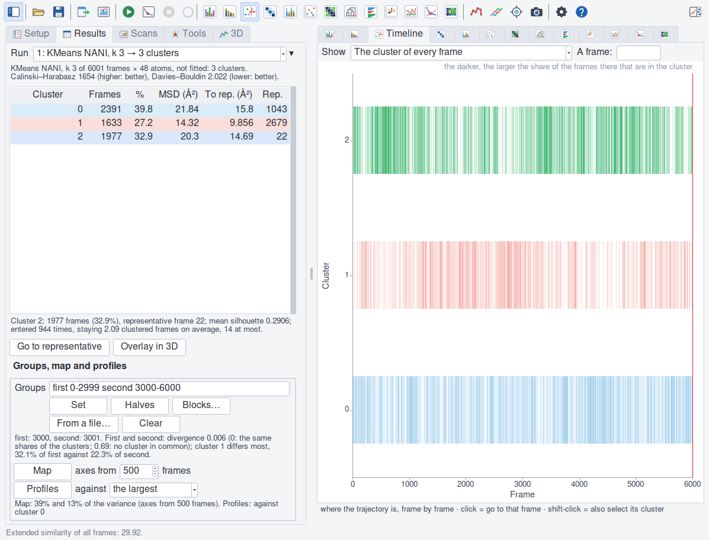
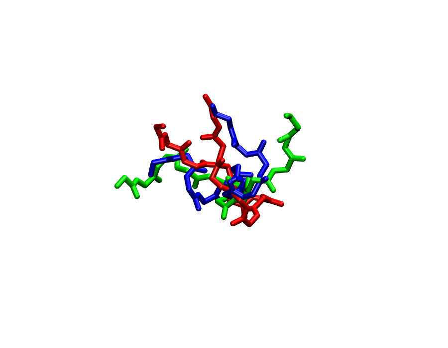
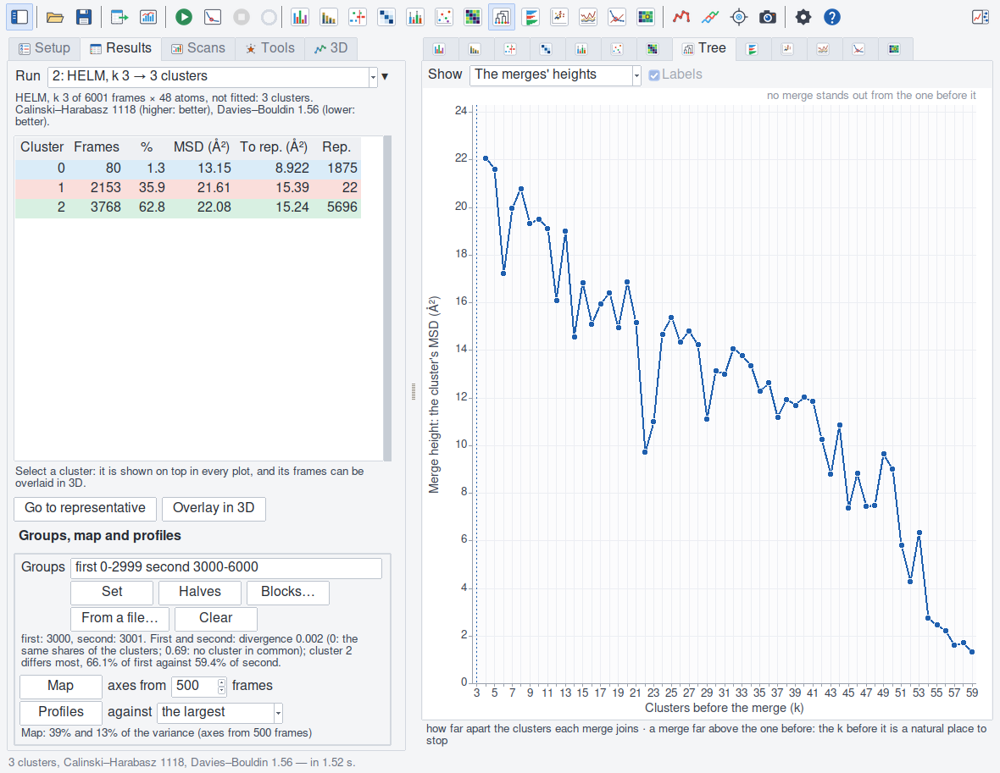
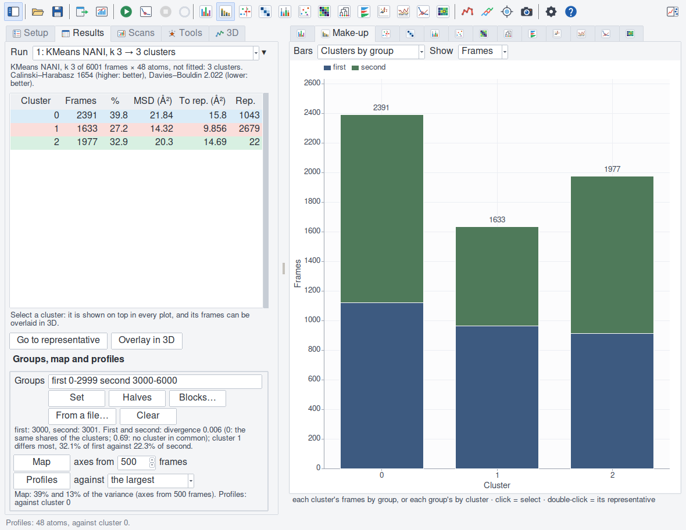

A complete analysis
===================

This tutorial clusters MDANCE's own example from start to end, in the
window and in a script, and reads what each step says. The trajectory is
the tau peptide that MDANCE's Python package ships: 6001 frames of a
flexible seven-residue peptide. Every number here was made with the
``vmdance`` command (``docs/tools/tutorial_numbers.tcl`` makes them
again); yours will be the same with the same backend.

You need VMD 2.1, VMDance and CPP-MDANCE (:doc:`install`), and the data:
``pip install mdance``, then the files ``aligned_tau.pdb`` and
``aligned_original_tau_6K.dcd`` of the package's ``mdance/data`` folder
(``python -c "import mdance, os; print(os.path.dirname(mdance.__file__))"``
says where it is).

1. Load the trajectory
----------------------

**File ▸ New Molecule** in VMD: the PDB, then the DCD into the same
molecule. The PDB brings a frame of its own, which is not part of the
trajectory MDANCE clusters: delete it (in the **Main** window's frame
list, or with the command below). The frames are already superposed on the
peptide's backbone, so no fit is needed (Setup says so itself: step 2).

.. code-block:: tcl

   set m [mol new aligned_tau.pdb]
   mol addfile aligned_original_tau_6K.dcd waitfor all
   animate delete beg 0 end 0 $m      ;# the PDB's own frame: 6001 left

Open **Analysis ▸ VMDance** (VMD 2's main window has no Extensions menu;
in VMD 1.9 it is **Extensions ▸ Analysis ▸ VMDance**).

   The window: (1) the toolbar; (2) the panes — Setup, Results, Scans,
   Tools, 3D; (3) the plots' tabs; (4) the plot; (5) its options; (6) what
   the pointer is on; (7) the status line.

2. Choose what to cluster
-------------------------

**Setup ▸ What to cluster**: the molecule, the atoms ``backbone`` (48
atoms), every frame. The atoms decide what "alike" means: the backbone
compares the peptide's folds, its side chains are left out. *Fit to the
first frame* stays off, and the note under it says why it can: *Not fitted.
From the first frame: 4.15 Å as they are, 3.96 Å fitted: the frames look
superposed.* (A trajectory that was not aligned is far from its first
frame as it is and near it once fitted: the note then turns red-brown and
says to tick Fit.) The algorithm:
KMeans NANI, seeded by ``CompSim`` (complementary similarity: the seeds
come from the densest frames). These four choices — atoms, superposition,
frames, algorithm — shape every number that follows (:doc:`algorithms`).

3. How many clusters?
---------------------

**Scans ▸ Elbow**, k from 2 to 12, *Stability* ticked, **Scan** (21 s):
the same clustering at every k, and the same again from NANI's four
seedings that draw no random number, to see whether the clusters depend on
the seeding.

   Calinski–Harabasz (blue), Davies–Bouldin (red) and the stability
   (bars) at every k; the panel gives k 3's clusters' shares.

.. list-table::
   :header-rows: 1
   :widths: 8 24 24 22 22

   * - k
     - Calinski–Harabasz (higher: better)
     - Davies–Bouldin (lower: better)
     - Variance explained
     - Stability (1: the same clusters)
   * - 2
     - 2364
     - 1.56
     - 28%
     - 1.00
   * - 3
     - 1654
     - 2.02
     - 36%
     - 0.99
   * - 4
     - 1333
     - 2.10
     - 40%
     - 0.75
   * - 5
     - 1147
     - 2.20
     - 43%
     - 0.68
   * - 6
     - 1036
     - 2.04
     - 46%
     - 0.69
   * - 7
     - 903
     - 2.24
     - 47%
     - 0.63
   * - 8
     - 850
     - 2.07
     - 50%
     - 0.52
   * - 12
     - 673
     - 1.96
     - 55%
     - 0.53

The Elbow plot rings the values the scores point to, and the Scans box
(and ``vmdance elbow suggest``) says them in words: *Davies–Bouldin: lowest
at k 2, sharpest dip at k 6; Calinski–Harabasz: highest at k 2; seedings
agree (0.9 or more) at k 2, 3* (the line above the plot says the same,
shorter). These are three readings, and they do not agree:

- **The scores are best at k 2.** Davies–Bouldin is lowest there (1.56)
  and Calinski–Harabasz highest (it falls at every k, as it does on
  structures that form no well-separated states). Two clusters are the
  best-separated partition, and a coarse one.
- **Davies–Bouldin dips most sharply at k 6**: 2.04, between 2.20 at k 5
  and 2.24 at k 7. This is MDANCE's second criterion (the largest second
  derivative of Davies–Bouldin; its first is the lowest value), and 6 is
  the k MDANCE's own tutorial goes on with. It says where the score bends:
  six clusters are better separated than five or seven.
- **The seedings agree only at k 2 and 3** (stability 1.00 and 0.99). At
  k 4 it is 0.75, at k 6 0.69, and about 0.5 from k 8: there the clusters
  change with the seeding.

Neither reading is wrong; they answer different questions. k 6 is where
the score bends. Only up to k 3 are the clusters the same whatever the
seeding: at k 6 another seeding gives other clusters. The variance the
clusters explain (*Scores ▸ Variance explained*) settles nothing here: it
rises ever more slowly, from 28% at k 2 to 55% at k 12, with no sharp
bend.

This tutorial goes on with **k 3**, for that reason: what it reads off the
clusters below — their populations, their make-up by half — should not
depend on how k-means was started. To follow MDANCE's tutorial, or for a
finer partition, take k 6 (``vmdance elbow load 6``: 691, 1178, 985, 1177,
1149 and 821 frames), and say with it that its clusters depend on the
seeding.

4. Cluster
----------

Double-click k 3 in the Elbow plot (or ``vmdance elbow load 3``): it is
made the clustering, a run of its own in **Results**.

   The clusters, and the Timeline: the cluster of every frame.

The clusters hold 2391, 1633 and 1977 frames (40%, 27% and 33%). The mean
silhouette is 0.25 — the clusters are loose, their frames not much closer
to their own cluster than to the next. That is the silhouette from the
clusters' mean structures, which is never below zero for k-means; from
every frame (the Silhouette's option *From*: *Every frame*) the mean is
0.27, and 537 frames (9%) are below zero: nearer another cluster's frames
than their own's. The trajectory stays about two
frames in a cluster before it moves on (**Residence**: 2.15, 1.94 and 2.09
frames on average, 20, 12 and 14 at most): the 6001 frames
are far apart in time, and the peptide changes between any two. The
**Timeline** shows it: with more frames than pixels its lanes are shaded
by each cluster's share of the frames there, and its view *Each cluster's
share so far* draws the populations settling (every cluster has been seen
by frame 30).

Click a cluster in the table: it is drawn on top in every plot.
Double-click it: VMD goes to its representative frame. **3D ▸ Colour by
cluster** colours the structure by the current frame's cluster as the
trajectory plays; **Representatives** draws them all at once.

   The representatives, each in its cluster's colour.

5. A second opinion
-------------------

Two other algorithms answer "how many" their own way.

**HELM**, from 60 small clusters merged two by two to 3 (Setup ▸ HELM, k 3,
*initial* 60): the Tree plot's *merges' heights* draws how far apart the
clusters each merge joins. A merge far above the one before marks a
natural k. Here the heights climb gently — the last eight merges, from 11
clusters to 4, are all between 17 and 22 Ų — and the plot says so: *no
merge stands out from the one before it*. (The largest step, 2.3 times the
merge before, is from 53 clusters to 52, among the first, finest merges:
it says nothing of a small k, and is not marked.)

   HELM's merges' heights: no jump at a small k.

**eQUAL** finds as many clusters as a radius makes (Scans ▸ Elbow, with
eQUAL chosen in Setup: the box then asks for radii, and **Suggest** proposes
a range from the frames themselves — 4.4 to 14 every 1.1 here, from the
distances between 147 of them): 384 clusters at a radius of 4 Ų, 121 at 6,
47 at 8, 20 at 10, 10 at 12 — no plateau, where several radii would give the
same clusters. (The radius is MDANCE's MSD: 8 Ų is an RMSD of 4 Što the
seed, √(2 × 8).)

All three say the same: the peptide's conformations form a continuum, not a
few well-separated states. k 3 is a stable, useful partition of it — the
three broad shapes the peptide takes — not three states with barriers
between them. Say so when you report it.

6. Compare groups: has the run converged?
-----------------------------------------

**Results ▸ Groups**: **Halves** (or type ``first 0-2999 second
3000-6000`` and **Set**). The two
halves of the trajectory are now groups, and the **Make-up** plot shows
each cluster by half.

   Each cluster by the half of the trajectory its frames came from.

Both halves visit all three clusters — no state is missing from either —
but not equally: cluster 1 holds 964 frames of the first half and 669 of
the second. The line under the Groups box says it in a number: *First and
second: divergence 0.006 (0: the same shares of the clusters; 0.69: no
cluster in common); cluster 1 differs most, 32.1% of first against 22.3%
of second.* The halves are alike, not the same: the populations have not
settled to better than ten points of a share, and a longer run, or more
replicas, would change them. **Map** places every frame on the first two
principal components (39% and 13% of the variance), coloured by half, each
cluster's representative ringed; and
**Profiles** says, residue by residue, where the clusters differ from the
most populated one (:doc:`groups`).

7. Keep it
----------

**File ▸ Save session** keeps every run, the scans, the groups, the map and
the profiles; **File ▸ Export results** writes the tables (each with a
header saying how it was made) and the structures; **File ▸ Create
figures** writes the plots as PDF, PNG or EPS, at the size and text size
of a paper's column or a slide (:doc:`files`).

The same in a script
--------------------

Every step above is a ``vmdance`` command, in VMD's console or in text-mode
VMD (``vmd -dispdev text -e tau.tcl``):

.. code-block:: tcl

   package require vmdance
   set m [mol new aligned_tau.pdb]
   mol addfile aligned_original_tau_6K.dcd waitfor all
   animate delete beg 0 end 0 $m
   vmdance alignment -mol $m -sel backbone  ;# as_is 4.146 fitted 3.956 … superposed 1
   # how many clusters: the scores and the stability at k 2 to 12
   vmdance elbow -mol $m -sel backbone -kinit CompSim -from 2 -to 12 -stability 1
   vmdance elbow suggest                    ;# db_lowest 2 … db_dip 6 … ch_highest 2 … stable {2 3} …
   vmdance elbow load 3                     ;# k 3: the clustering
   vmdance clusters                         ;# the table
   vmdance silhouette                       ;# mean 0.25 (from the clusters' mean structures)
   vmdance silhouette -kind pairs           ;# mean 0.27 (from every frame)
   # the two halves as groups
   vmdance groups -blocks 2                 ;# first 0-2999, second 3000-6000
   vmdance makeup                           ;# 0 {1122 1269} 1 {964 669} 2 {914 1063}
   vmdance groups compare                   ;# pairs {{first second 0.006155 0.09841 1}} words {…}
   vmdance map
   vmdance profiles
   # a second opinion: HELM's merges' heights, eQUAL's radius
   vmdance -mol $m -sel backbone -algorithm helm -k 3 -initial 60
   dict get [vmdance tree] heights
   vmdance radii -mol $m -sel backbone      ;# … from 4.4 to 14 by 1.1
   vmdance elbow -mol $m -sel backbone -algorithm equal -radii {4 6 8 10 12}
   # keep it
   vmdance run 1
   vmdance session save tau.vmdance
   vmdance export results -prefix tau
   vmdance figures figures -plots {elbow populations makeup map} -formats {pdf png} -size column

What to report
--------------

Whoever reads your clustering needs: the atoms and the superposition
(fitted, and on what, or not); the
frames (all, a range, every n-th) and their time apart; the algorithm, its
parameters and the backend (CPP-MDANCE's version); how k was chosen (which
reading of the scores, the stability, a second algorithm's view); the
clusters' sizes and silhouette, and which silhouette; and, when there are
groups, each cluster's make-up. The tables
the plugin exports carry most of it in their headers.
