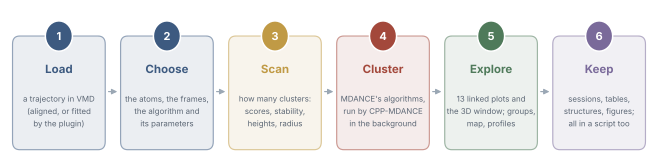
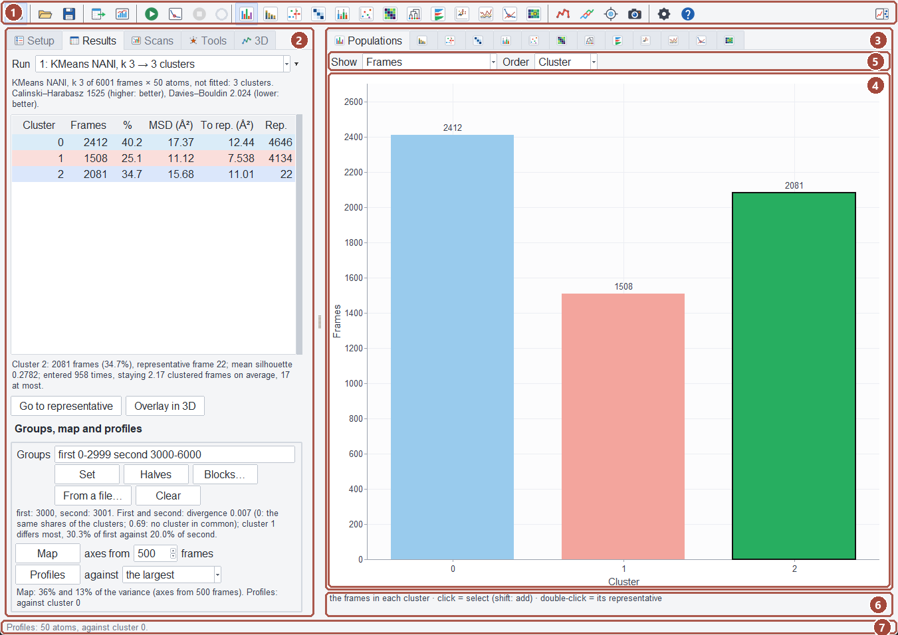
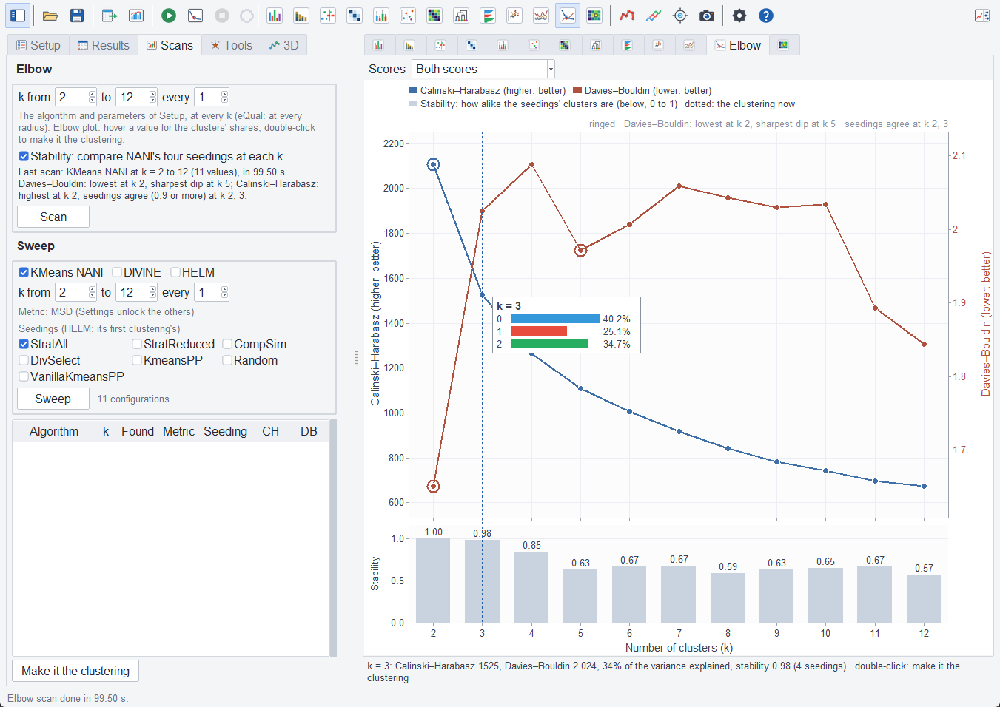
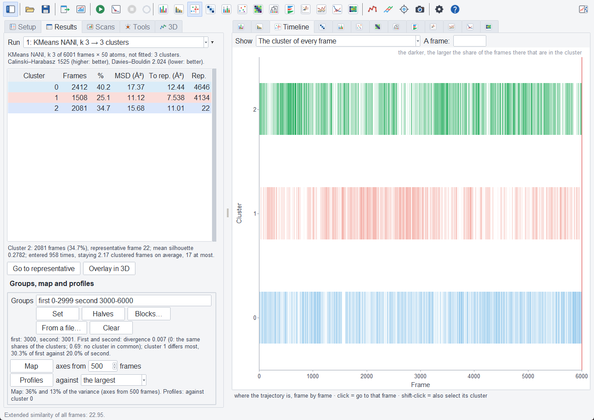
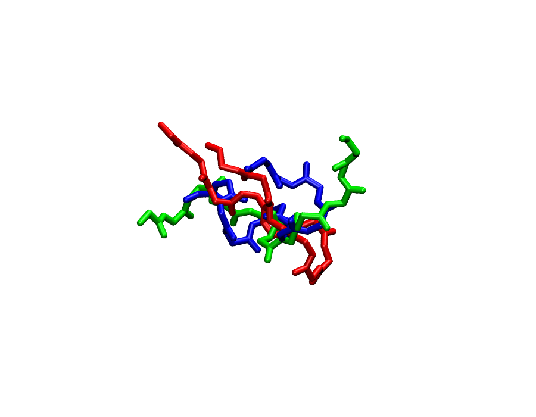
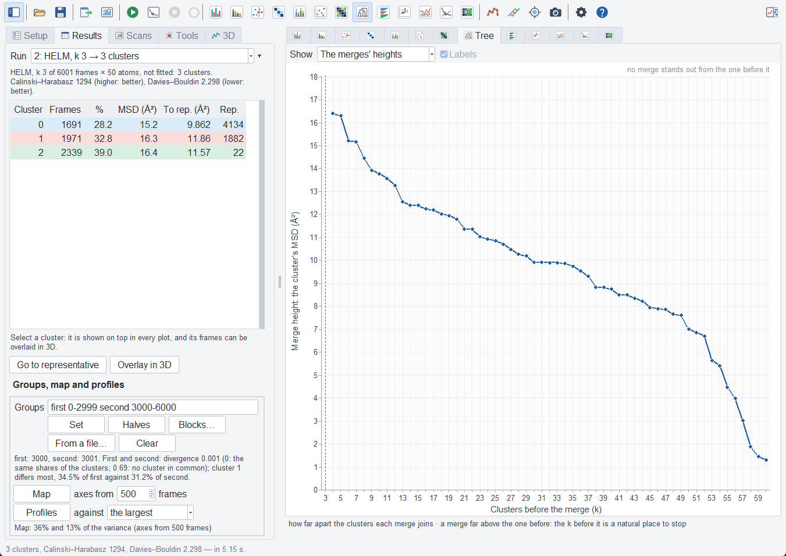
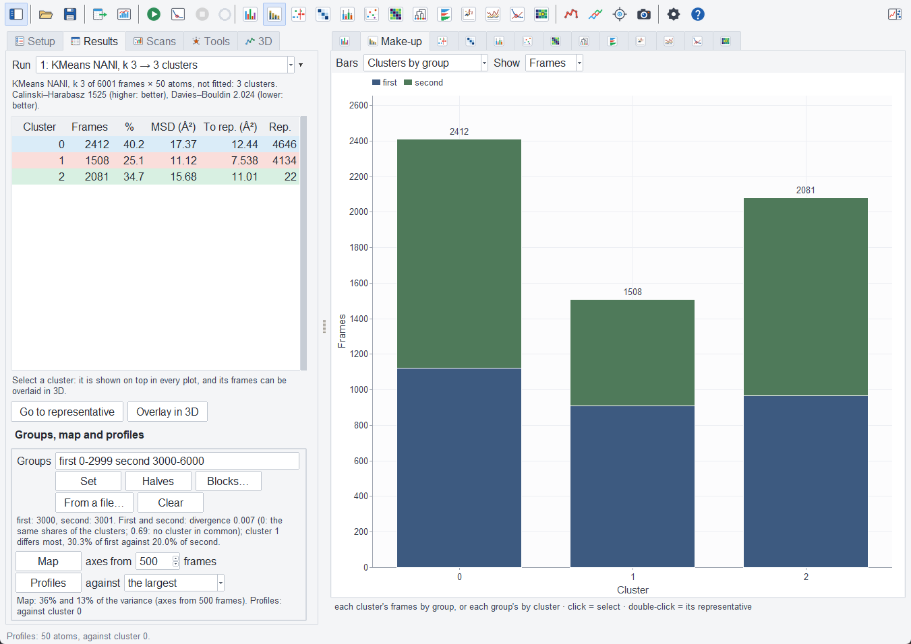

A complete analysis
===================

This tutorial clusters MDANCE's own example from start to end, in the
window and in a script. It also reads what each step says.

The trajectory is the tau peptide that MDANCE's Python package ships: 6001
frames of a flexible twelve-residue peptide, its ends capped. Every number
here was made with the ``vmdance`` command, and
``docs/tools/tutorial_numbers.tcl`` makes them again. Yours will be the
same with the same backend.

You need:

- a VMD built with Tcl/Tk 8.6 (VMD 2; tested in 2.1);
- VMDance and CPP-MDANCE (:doc:`install`);
- the data: ``pip install mdance``, then the files ``aligned_tau.pdb`` and
  ``aligned_original_tau_6K.dcd`` of the package's ``mdance/data`` folder.
  ``python -c "import mdance, os; print(os.path.dirname(mdance.__file__))"``
  says where it is.

1. Load the trajectory
----------------------

In VMD, use **File ▸ New Molecule**: load the PDB, then the DCD into the
same molecule.

The PDB brings a frame of its own, which is not part of the trajectory
MDANCE clusters. Delete it, in the **Main** window's frame list or with
the command below. The molecule then has **6001 frames** (6002 with it;
Setup's frame count says which).

The frames are already superposed on the peptide's backbone, so no fit is
needed. Setup says so itself (step 2).

.. code-block:: tcl

   set m [mol new aligned_tau.pdb]
   mol addfile aligned_original_tau_6K.dcd waitfor all
   animate delete beg 0 end 0 $m      ;# the PDB's own frame: 6001 left

Open **Analysis ▸ VMDance**. VMD 2's main window has no Extensions menu.
In VMD 1.9, it is **Extensions ▸ Analysis ▸ VMDance**.

   The window: (1) the toolbar; (2) the panes — Setup, Results, Scans,
   Tools, 3D; (3) the plots' tabs; (4) the plot; (5) its options; (6) what
   the pointer is on; (7) the status line.

2. Choose what to cluster
-------------------------

In **Setup ▸ What to cluster**, choose:

- the molecule;
- the atoms ``resid 3 to 12 and name CA N C O H``: 50 atoms, the backbone
  of residues 3 to 12 and its amide hydrogens (those MDANCE's own tutorial
  clusters);
- every frame (6001).

The atoms decide what "alike" means. The backbone compares the peptide's
folds. Its side chains are left out, and so are the two flexible ends.

*Fit to the first frame* stays off, and the note under it says why it can:
*Not fitted. From the first frame: 3.71 Å as they are, 3.3 Å fitted: the
frames look superposed.* A trajectory that was not aligned is far from its
first frame as it is, and near it once fitted. The note then turns
red-brown and says to tick Fit.

The algorithm is KMeans NANI, with **Seeding** set to *Complementary
similarity* (``CompSim``). With it, the seeds come from the densest
frames. The default is *Stratified, all frames*.

These four choices shape every number that follows: the atoms, the
superposition, the frames and the algorithm (:doc:`algorithms`).

3. How many clusters?
---------------------

Open **Scans ▸ Elbow**. Set k from 2 to 12, tick *Stability*, and press
**Scan** (a minute or two). The scan makes the same clustering at every k.
It makes it again from NANI's four seedings that draw no random number, to
see whether the clusters depend on the seeding.

   Calinski–Harabasz (blue), Davies–Bouldin (red) and the stability
   (bars) at every k. The panel gives k 3's clusters' shares.

.. list-table::
   :header-rows: 1
   :widths: 8 24 24 22 22

   * - k
     - Calinski–Harabasz (higher: better)
     - Davies–Bouldin (lower: better)
     - Variance explained
     - Stability (1: the same clusters)
   * - 2
     - 2109
     - 1.65
     - 26%
     - 1.00
   * - 3
     - 1525
     - 2.02
     - 34%
     - 0.98
   * - 4
     - 1263
     - 2.09
     - 39%
     - 0.85
   * - 5
     - 1109
     - 1.97
     - 43%
     - 0.63
   * - 6
     - 1006
     - 2.01
     - 46%
     - 0.67
   * - 7
     - 916
     - 2.06
     - 48%
     - 0.67
   * - 8
     - 840
     - 2.04
     - 50%
     - 0.59
   * - 9
     - 781
     - 2.03
     - 51%
     - 0.63
   * - 10
     - 744
     - 2.03
     - 53%
     - 0.65
   * - 11
     - 695
     - 1.89
     - 54%
     - 0.67
   * - 12
     - 675
     - 1.84
     - 55%
     - 0.57

The Elbow plot rings the values the scores point to. The Scans box (and
``vmdance elbow suggest``) says them in words: *Davies–Bouldin: lowest
at k 2, sharpest dip at k 5; Calinski–Harabasz: highest at k 2; seedings
agree (0.9 or more) at k 2, 3*. The line above the plot says the same,
shorter.

These are three readings, and they do not agree:

- **The scores are best at k 2.** Davies–Bouldin is lowest there (1.65)
  and Calinski–Harabasz highest. Calinski–Harabasz falls at every k, as it
  does on structures that form no well-separated states. Two clusters are
  the best-separated partition, and a coarse one.
- **Davies–Bouldin dips most sharply at k 5**: 1.97, between 2.09 at k 4
  and 2.01 at k 6. This is MDANCE's second criterion, the largest second
  derivative of Davies–Bouldin. Its first is the lowest value. MDANCE's
  own tutorial goes on with k 6, next to it. The dip says where the score
  bends: five clusters are better separated than four or six.
- **The seedings agree only at k 2 and 3** (stability 1.00 and 0.98). At
  k 4 it is 0.85, and from k 5 between 0.57 and 0.67. There the clusters
  change with the seeding.

Neither reading is wrong: they answer different questions. k 5 is where
the score bends. Only up to k 3 are the clusters the same whatever the
seeding. At k 5 or 6, another seeding gives other clusters.

The variance the clusters explain (*Scores ▸ Variance explained*) settles
nothing here. It rises ever more slowly, from 26% at k 2 to 55% at k 12,
with no sharp bend.

This tutorial goes on with **k 3**, for that reason. What it reads off the
clusters below, their populations and their make-up by half, should not
depend on how k-means was started.

To follow MDANCE's tutorial, or for a finer partition, take k 6
(``vmdance elbow load 6``: 699, 1093, 1223, 1292, 721 and 973 frames). Say
with it that its clusters depend on the seeding.

4. Cluster
----------

Double-click k 3 in the Elbow plot (or ``vmdance elbow load 3``). It is
made the clustering, a run of its own in **Results**.

   The clusters, and the Timeline: the cluster of every frame.

The clusters hold 2412, 1508 and 2081 frames (40%, 25% and 35%).

The mean silhouette is 0.25. The clusters are loose: their frames are not
much closer to their own cluster than to the next. That is the silhouette
from the clusters' mean structures, which is never below zero for
k-means. From every frame (the Silhouette's option *From*: *Every frame*),
the mean is 0.27, and 586 frames (10%) are below zero. These frames are
nearer another cluster's frames than their own's.

The trajectory stays about two frames in a cluster before it moves on
(**Residence**: 2.19, 1.91 and 2.17 frames on average, 22, 12 and 17 at
most). The 6001 frames are far apart in time, and the peptide changes
between any two.

The **Timeline** shows it. With more frames than pixels, its lanes are
shaded by each cluster's share of the frames there. Its view *Each
cluster's share so far* draws the populations settling: every cluster has
been seen by frame 30.

- Click a cluster in the table: it is drawn on top in every plot.
- Double-click it: VMD goes to its representative frame.
- **3D ▸ Colour by cluster** colours the structure by the current frame's
  cluster as the trajectory plays.
- **Representatives** draws them all at once.

   The representatives, each in its cluster's colour.

5. A second opinion
-------------------

Two other algorithms answer "how many" their own way.

**HELM** merges 60 small clusters two by two, down to 3. In Setup ▸ HELM,
set *Clusters (k)* to 3 and *Start from* to 60, then press **Cluster**.
The Tree plot's *merges' heights* draws how far apart the clusters each
merge joins. A merge far above the one before marks a natural k.

Here the heights climb gently. The last eight merges, from 11 clusters
down to 3, are all between 13.6 and 16.4 Ų. The plot says so: *no merge
stands out from the one before it*. The largest step, 1.6 times the merge
before, is from 57 clusters to 56. It is among the first, finest merges:
it says nothing of a small k, and is not marked.

   HELM's merges' heights: no jump at a small k.

**eQual** finds as many clusters as a radius makes. Choose eQual in Setup,
then open Scans ▸ Elbow: the box then asks for radii. **Suggest** proposes
a range from the frames themselves: 3.4 to 10 every 0.73 here, from the
distances between 147 of them.

Scanned at 4 to 12 every 2 (typed in the box, then **Scan**), eQual makes
194 clusters at a radius of 4 Ų, 55 at 6, 19 at 8, 9 at 10 and 7 at 12.
There is no plateau, where several radii would give the same clusters.
The radius is MDANCE's MSD: 8 Ų is an RMSD of 4 Što the seed,
√(2 × 8).

All three say the same: the peptide's conformations form a continuum, not
a few well-separated states. k 3 is a stable, useful partition of it: the
three broad shapes the peptide takes. It is not three states with
barriers between them. Say so when you report it.

6. Compare groups: has the run converged?
-----------------------------------------

First choose the k 3 clustering again in **Results ▸ Run**: HELM's is the
current run now. Then, in **Results ▸ Groups**, press **Halves**, or type
``first 0-2999 second 3000-6000`` and **Set**. The two halves of the
trajectory are now groups. The **Make-up** plot shows each cluster by
half.

   Each cluster by the half of the trajectory its frames came from.

Both halves visit all three clusters: no state is missing from either. But
they do not visit them equally. Cluster 1 holds 909 frames of the first
half and 599 of the second.

The line under the Groups box says it in a number: *First and second:
divergence 0.007 (0: the same shares of the clusters; 0.69: no cluster in
common); cluster 1 differs most, 30.3% of first against 20.0% of second.*

The halves are alike, not the same. The populations have not settled to
better than ten points of a share. A longer run, or more replicas, would
change them.

Two more plots look at the groups (:doc:`groups`):

- **Map** places every frame on the first two principal components (36%
  and 13% of the variance), coloured by half, with each cluster's
  representative ringed.
- **Profiles** says, residue by residue, where the clusters differ from
  the most populated one.

7. Keep it
----------

- **File ▸ Save session** keeps every run, the last elbow scan and the
  last sweep, the groups, the map and the profiles. The last elbow scan is
  eQual's radii here: step 5 replaced the scan by k.
- **File ▸ Export results** writes the tables and the structures. Each
  table has a header saying how it was made.
- **File ▸ Create figures** writes the plots as PDF, PNG or EPS, at the
  size and text size of a paper's column or a slide (:doc:`files`).

The same in a script
--------------------

Every step above is a ``vmdance`` command. The script below runs in VMD's
console or in text-mode VMD (``vmd -dispdev text -e tau.tcl``), but for
its last line: figures need VMD's window (``vmd -e tau.tcl``). It keeps
the work before the second opinion, whose eQual scan would replace the
scan by k:

.. code-block:: tcl

   package require vmdance
   set m [mol new aligned_tau.pdb]
   mol addfile aligned_original_tau_6K.dcd waitfor all
   animate delete beg 0 end 0 $m           ;# 6001 frames
   set sel "resid 3 to 12 and name CA N C O H"
   vmdance alignment -mol $m -sel $sel      ;# as_is 3.711 fitted 3.304 … superposed 1
   # how many clusters: the scores and the stability at k 2 to 12
   vmdance elbow -mol $m -sel $sel -kinit CompSim -from 2 -to 12 -stability 1
   vmdance elbow suggest                    ;# db_lowest 2 … db_dip 5 … ch_highest 2 … stable {2 3} …
   vmdance elbow load 3                     ;# k 3: the clustering
   vmdance clusters                         ;# the table
   vmdance silhouette                       ;# mean 0.25 (from the clusters' mean structures)
   vmdance silhouette -kind pairs           ;# mean 0.27 (from every frame)
   # the two halves as groups
   vmdance groups -blocks 2                 ;# first 0-2999, second 3000-6000
   vmdance makeup                           ;# 0 {1123 1289} 1 {909 599} 2 {968 1113}
   vmdance groups compare                   ;# pairs {{first second 0.007143 0.1034 1}} words {…}
   vmdance map
   vmdance profiles
   # keep it
   vmdance session save tau.vmdance
   vmdance export results -prefix tau
   # a second opinion: HELM's merges' heights, eQual's radius
   vmdance -mol $m -sel $sel -algorithm helm -k 3 -initial 60
   dict get [vmdance tree] heights
   vmdance radii -mol $m -sel $sel          ;# … from 3.4 to 10 by 0.73
   vmdance elbow -mol $m -sel $sel -algorithm equal -radii {4 6 8 10 12}
   # figures of the k 3 run (VMD's window needed; the elbow is eQual's now)
   vmdance run 1
   vmdance figures figures -plots {populations makeup map} -formats {pdf png} -size column

What to report
--------------

Whoever reads your clustering needs:

- the atoms and the superposition (fitted, and on what, or not);
- the frames (all, a range, every n-th) and their time apart;
- the algorithm, its parameters and the backend (CPP-MDANCE's version);
- how k was chosen (which reading of the scores, the stability, a second
  algorithm's view);
- the clusters' sizes and silhouette, and which silhouette;
- when there are groups, each cluster's make-up.

The tables the plugin exports carry most of it in their headers.
