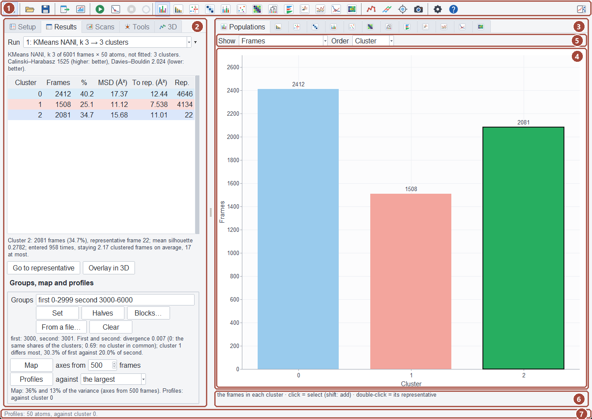
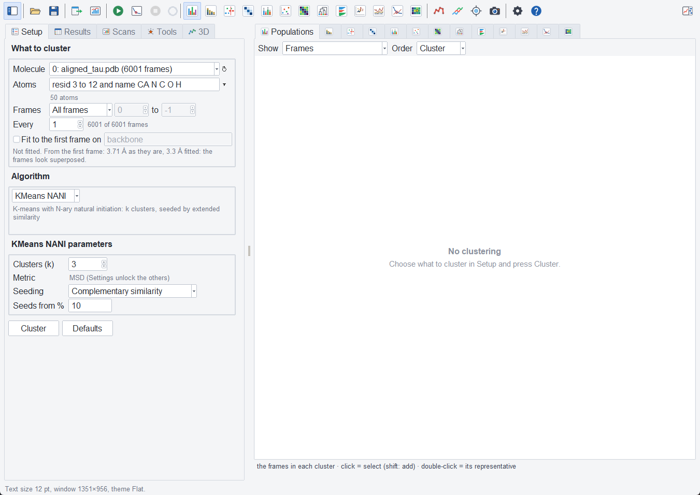
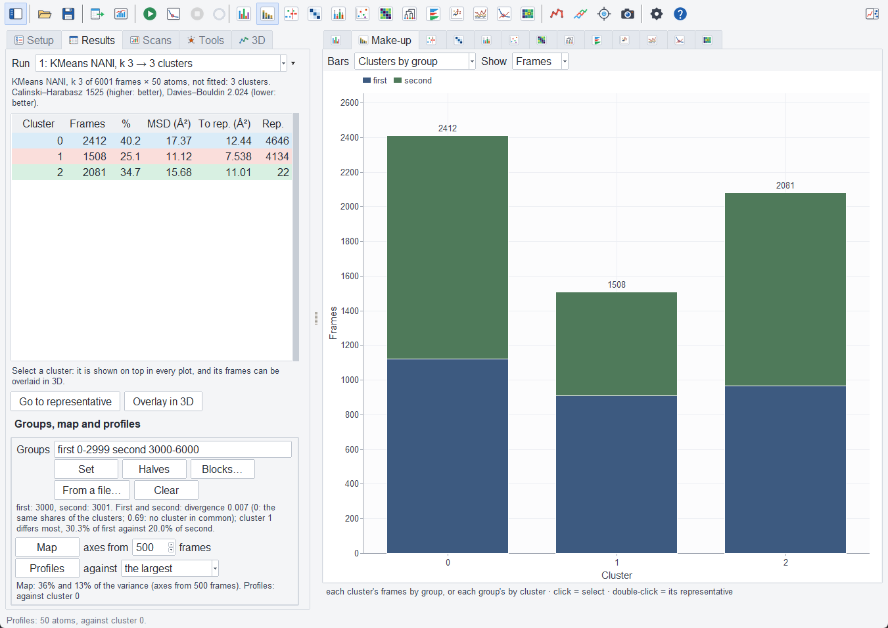
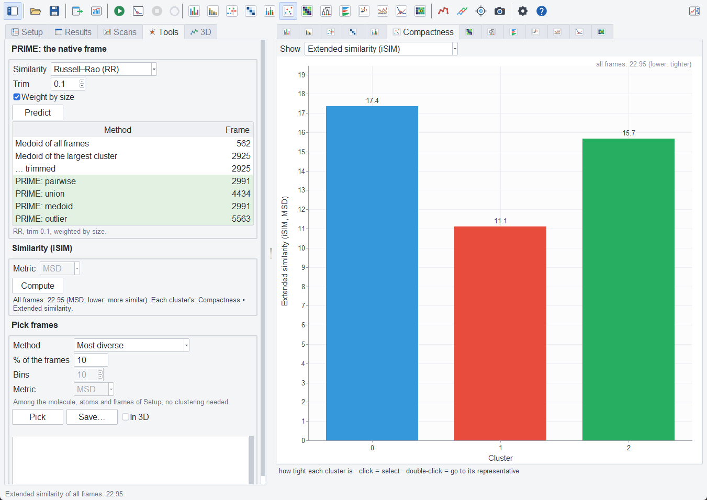
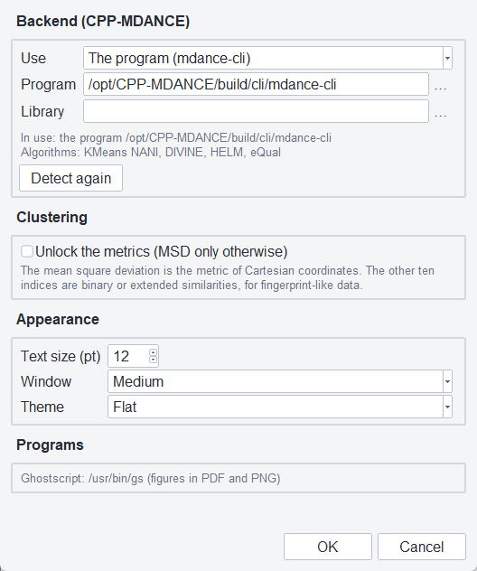

The window
==========

   (1) The toolbar; (2) the panes: Setup, Results, Scans, Tools, 3D;
   (3) the plots' tabs; (4) the plot; (5) its options; (6) what the
   pointer is on; (7) the status line.

The window has:

- a toolbar on top;
- on the left, a panel of five tabs: **Setup**, **Results**, **Scans**,
  **Tools** and **3D**;
- on the right, the plots, and the **Plot options** panel. It can be shown
  instead of the row of options above each plot.

Both side panels can be hidden, with the toolbar's first and last buttons.

A plot's tab shows its icon, and its name when it is in front. Rest the
pointer on a tab, and it says its name and what it shows. The line at the
bottom says what the window last did. The line under the plots says what
the pointer is on. A left tab taller than the window (a small screen, a
large text size) scrolls, with the mouse wheel too.

While a job runs, what would start another job, change the results or draw
in 3D is off. It is off in an Export or Figures dialog left open too, and
also for a job started from the console. Setup stays open. What is changed
in it while a clustering runs is kept for the next one, and the line at the
bottom says so. Left unchanged, Setup shows the settings of the clustering
shown. It does so also when a script chooses a run or opens a session right
after a job.

The toolbar
-----------

In order:

- the left panel;
- open and save a session;
- export results and create figures;
- **Cluster**, **Elbow scan** and **Cancel**, with the ring of the running
  job's progress;
- the thirteen plots;
- colour by cluster, every representative, go to the selected cluster's
  representative, render the 3D view;
- Settings and the quick guide;
- the plot options.

Setup
-----

**What to cluster**:

- the molecule. The list follows VMD; ↻ reads it again after frames were
  added to one.
- the atoms, in VMD's selection language, with a menu of common ones and
  the number of atoms they match. Some selections are refused (below).
- the frames: all, or a range (-1 being the last), and every n-th, with
  the number of frames they give.
- **Fit to the first frame on** a selection. It superposes every frame on
  the first clustered one before clustering. The fit is made on the
  values: VMD's coordinates are not moved. It is off unless ticked.

A selection whose atoms can change with the frame is refused: ``within``,
``nearest``, ``x``, ``user`` …, or a macro of them. A clustering compares
the same atoms in every frame. A value in quotes, ``chain "x"``, is read as
a value. A selection that still lists more than 50 000 separate values,
once its index lists are written as ranges, is refused too: VMD crashes
freeing about 100 000.

A note under the Fit box says:

- with a fit, the atoms it is made on (*Fitted on 50 atoms*);
- without one, how far a sample of the frames (the first and 20 others) is
  from the first, as they are and once fitted on it: *Not fitted. From the
  first frame: 3.71 Å as they are, 3.3 Å fitted: the frames look
  superposed.*

When the frames do not look superposed, the note is a warning, in a
red-brown tone. It says to tick Fit unless the molecule's motion is what
you cluster. The rule: frames are not superposed when a fit halves their
distance from the first and takes an ångström off it. ↻ measures again,
after the coordinates were moved in VMD.

A fit ticked whose atoms the molecule lacks (``backbone`` of a Cα model) is
put on the clustered atoms, and the line at the bottom says so.

A run of every frame shows **All frames** in Setup. It does so also when a
scan's k made the clustering, or when the run came with a session. A range
belongs to the molecule it was typed for. Choosing another molecule puts
the frames back to all of them, and the line at the bottom says so.

**Algorithm**: KMeans NANI, DIVINE, HELM or eQual, with what it does. A
note under it:

- names the algorithms the backend was built without. The backend is asked
  again as the chooser opens, for a program rebuilt meanwhile.
- says when the library clusters. VMD then waits for each clustering, and
  the line at the bottom says so through it.
- says that *Automatic* took the library, finding no program.

**Parameters**: the chosen algorithm's (:doc:`parameters`). The other
algorithms keep what was typed in them. Fields that do not apply are
greyed:

- HELM's trim values without *Trim first*;
- HELM's first clustering with a label file;
- DIVINE's seeding with anchors other than NANI;
- DIVINE's Refine with NANI (a NANI split is a k-means already:
  :doc:`algorithms`);
- eQual's *Min. size* and *Largest MSD* without *Reject small clusters*
  and *Check similarity*;
- a seeding share that the seeding does not use.

DIVINE has no field to stop other than at k: ``-end-mode points`` is the
command's. **Metric** is the mean square deviation unless Settings unlock
the others. DIVINE's and eQual's metric is always the mean square
deviation, and the field says why. **Defaults** puts the algorithm's back.
A number left empty is refused (*-threshold is needed (Radius)*), never
taken as its default.

Under eQual's **Radius**, Setup writes the RMSD it stands for. A frame
joins a cluster when it is within √(2 × radius) Å of its seed. The radius
is MDANCE's MSD, in Ų, 2 by default. **Suggest a radius** proposes one
from the frames themselves: the distance a tenth of the pairs of about 150
of them are within. It replaces the default or an empty field. A radius
you typed is kept. It also proposes a range of radii for Scans ▸ Elbow
(:doc:`scans`).

**Cluster** checks the request first. An error names the option and what
to change (:doc:`algorithms`), and nothing runs. The messages name the
command's options. In the window, a line under them says which field each
is (*In the window: -sel is Atoms.*).

Results
-------

**Run**: every clustering is kept (the last 25). Choose one to see it
again: the Setup tab shows its settings. A run's name says its algorithm,
its k (eQual: its radius), its clusters, how many of them have no frames,
and whether it was fitted (*KMeans NANI, k 6 → 6 clusters (1 empty),
fitted*).

▾ renames or deletes the run, or clears every run, scan and pick. It also
**numbers its clusters by size**, the largest 0, as a new run. The run it
is made of keeps the backend's numbers, which are MDANCE's.

Under it, the clustering in words:

- what was clustered;
- *fitted on* a selection, or *not fitted*;
- the clusters, naming those without frames (*10 clusters (2 with no
  frames: 3 and 7)*);
- the two scores. Rest the pointer there for what they compare.

The **table of clusters** gives, for each cluster:

- its number;
- its frames, and their share;
- the mean square deviation within it (the backend's: *MSD (Ų)*);
- the mean RMSD² of its frames from its representative (*To rep. (Ų)*);
- the representative's frame (*Rep.*).

The two distances are in Å when the plots show lengths (:doc:`plots`).
Each row is tinted with its cluster's colour. Click a heading to sort.

Selecting rows selects clusters. Every plot draws them on top, the others
paler. **Overlay in 3D** draws their frames nearest their representative.
Double-click: go to the representative. Right-click: more. Under the
table, the selection in words: frames, share, representative, mean
silhouette, visits and residence.

**Groups, map and profiles**: each frame's group, that is the half of the
trajectory, replica, condition or method it came from. Type them as names
and VMD frames (``first 0-2999 second 3000-6000``) and press **Set**. The
other buttons:

- **Halves** makes the two halves of the clustered frames two groups;
- **Blocks…** makes any number of blocks;
- **From a file…** reads ``frame,group`` lines;
- **Clear** takes them away.

The line under the buttons gives each group's frames. It also says how
unlike the two most different groups are: the Jensen–Shannon divergence of
their shares of the clusters (0: the same shares; 0.69: no cluster in
common), and the cluster whose share differs most (:doc:`groups`).

- **Map** places the frames on their first two principal components (the
  axes from the frames given).
- **Profiles** measures each group's and cluster's fluctuations, atom by
  atom, and each cluster against one, chosen by name (*the largest*,
  *cluster 0* …).

The Make-up, Map and Profiles plots show them (:doc:`plots`). The command
sets the groups' colours (:doc:`command`).

Scans
-----

**Elbow**: the Setup's algorithm and parameters at every k from … to …
every …. With eQual chosen in Setup, the box shows the radii instead: at
every radius from … to … every …, and **Suggest**, which proposes them from
the frames.

**Stability** is the agreement between NANI's four seedings at each k. It
is KMeans NANI's only, greyed with the others. The Elbow plot shows it.
**Scan** (or the toolbar's Elbow scan) runs the scan.

Under them, the last scan and what it points to, in words:

- where Davies–Bouldin is lowest, and where it dips most;
- where Calinski–Harabasz is highest;
- the k the seedings agree on.

A scan cancelled after two values or more keeps them as the scan. Not
HELM's: its values are scored together at the end.

**Sweep**: every combination of the algorithms (KMeans NANI, DIVINE,
HELM), the range of k, the metrics and the seedings, with the number of
configurations. HELM's seedings are its first clustering's. HELM from a
label file and DIVINE's pair anchors run once, using none. The sweep has
its table and the Sweep plot. Sort the table by a heading. Its rows are
coloured:

- the row of the best Calinski–Harabasz green;
- of the best Davies–Bouldin blue;
- of the best on both teal;
- failures in red.

**Make it the clustering** (or a double-click) publishes a configuration as
a run. :doc:`scans` says more.

Tools
-----

- **PRIME**: the native-like frame of the clusters, with its similarity
  index, trim and weighting. A table gives its four predictions (their
  rows tinted green) and three medoid baselines. Double-click: go to the
  frame.
- **Similarity (iSIM)**: MDANCE's extended similarity of all frames, and of
  each cluster. The Compactness plot shows them.
- **Pick frames**: the most diverse, the outliers, a representative
  sample, the medoid or the outlier of the Setup's frames, without
  clustering. Then the list (double-click: go to the frame, on their
  molecule), **Save…** as PDB or DCD, and **In 3D**.

:doc:`tools` says more.

3D
--

:doc:`threed`: colour by cluster, every representative, the overlay, the
picked frames, their style, atoms and material, the user field, and the key
of the clusters' colours.

Settings
--------

**Backend**: automatic, the program or the library, and which program and
library (… browses). The dialog shows what is in use and what it was built
with. A program that did not answer within 3 s is not known, and every
algorithm is offered. *Detect again* asks again.

A backend chosen there is tried, not applied. The dialog says what it
gives "On OK". A job started meanwhile runs on the one in use, and Cancel
keeps that one. OK while a job runs says to wait for its end.

**Clustering**: unlock the metrics.

**Appearance**: the text size (8–24 pt), the window size and the theme.
The theme is *Automatic*, the platform's native look where VMD has one
(*macOS native* or *Native (Windows)*), *Flat*, or VMD's own.

The settings are kept in ``~/.vmdance.prefs``, which is read as data. The
command reads the backend chosen there too.

The window sizes are *Compact*, *Medium* and *Large*: 980 × 660, 1180 × 740
and 1380 × 880 at 12 pt, larger with the text. *Compact* is never narrower
than the panels need. *Medium* and *Large* are 200 and 400 pixels wider
than that (at 12 pt), so that the three differ in width with a large text
too. *Medium*, a new user's, and *Large* open tall enough to show every
left page whole, where the screen has room. *Compact* is the small one, and
its pages scroll.

On a small screen
-----------------

The window can be made much smaller than it opens: down to the toolbar,
the status line and a plot of 18 lines (about 1160 × 470 at 12 pt).

- A left page taller than the window scrolls. The wheel scrolls it over a
  table that shows all its rows too.
- The screen may have no room for the left panel, the plots and the plot
  options together (below about 1500 pixels wide at 12 pt). Then the plot
  options take the left panel's place while they are open. The left panel
  comes back when they close, and the status line says so.
- A window narrower than its toolbar puts the 3D, Settings and Help
  buttons on a second row.
- The dialogs (Export, Create figures, Settings) are never taller than the
  screen. Their sections scroll, and their buttons stay in view. Return
  presses the dialog's main button.
- A folder or a program's path too long for its field shows its end. The
  pointer on it shows the whole.

A session that opens with several notes on its molecules counts them in
the status line, and writes them in VMD's console.

Keys
----

Ctrl (⌘ on macOS) and:

- O: open;
- S: save (Shift: save as);
- E: export;
- P: figures;
- R: cluster;
- W: close;
- 1–9: the plots;
- Shift+L and Shift+O: the side panels.
