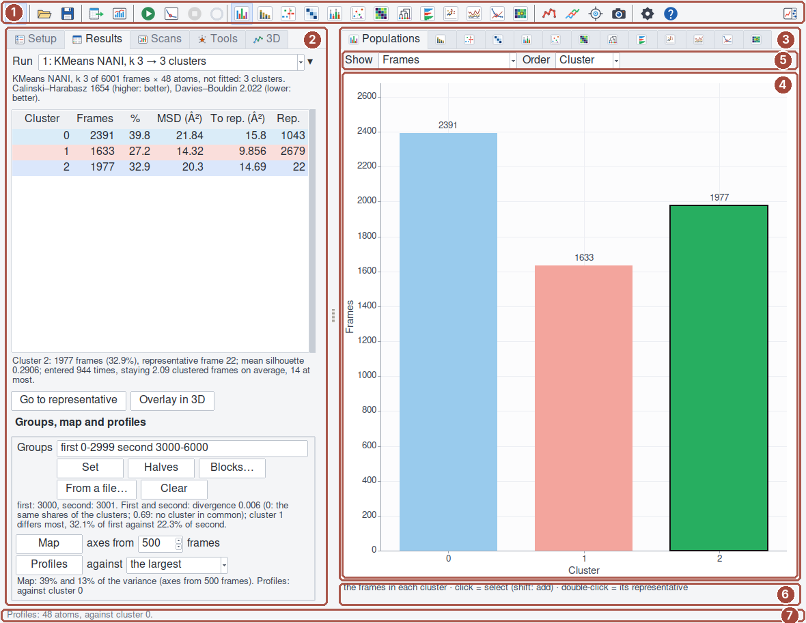
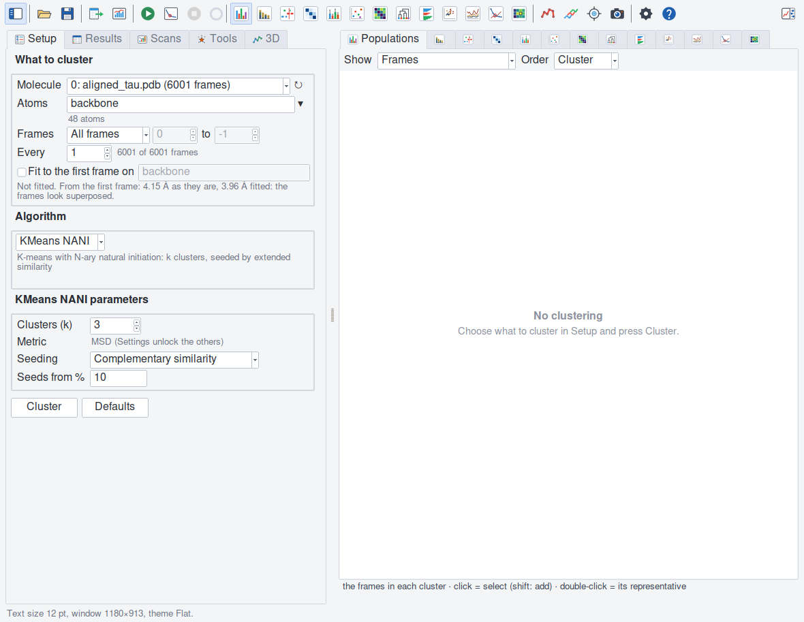
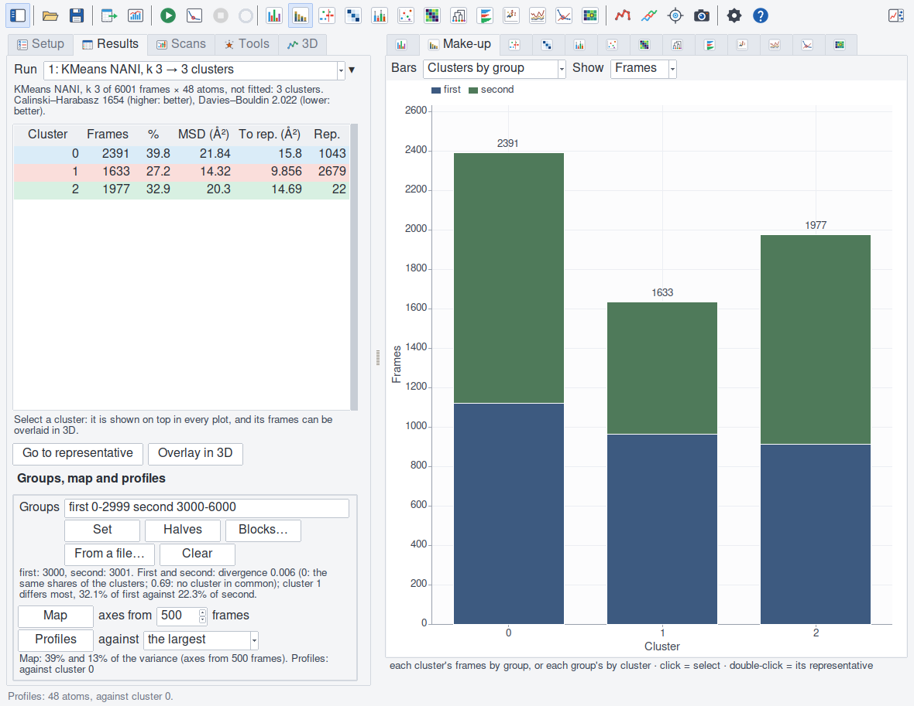
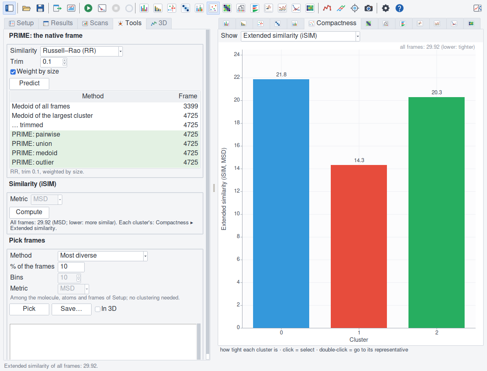
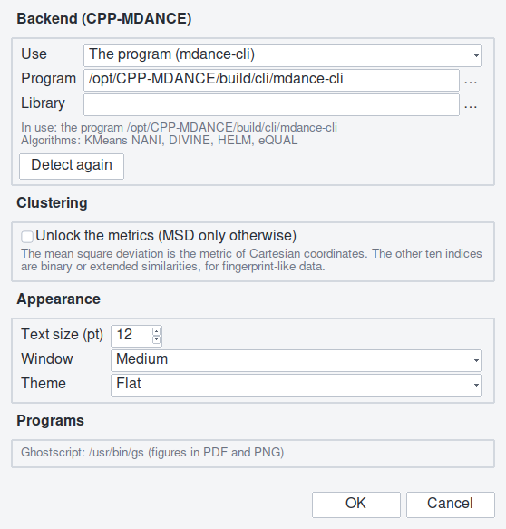

The window
==========

   (1) The toolbar; (2) the panes: Setup, Results, Scans, Tools, 3D;
   (3) the plots' tabs; (4) the plot; (5) its options; (6) what the
   pointer is on; (7) the status line.

A toolbar on top; on the left a panel of five tabs (**Setup**, **Results**,
**Scans**, **Tools**, **3D**); on the right the plots, and the **Plot
options** panel, which can be shown instead of the row of options above
each plot. Both side panels can be hidden (the toolbar's first and last
buttons). A plot's tab shows its icon, and its name when it is in front:
rest the pointer on a tab, and it says its name and what it shows. The
line at the bottom says what the window last did; the line
under the plots what the pointer is on. A left tab taller than the window
(a small screen, a large text size) scrolls, with the mouse wheel too.
While a job runs, what would start another, change the results or draw in
3D is off (in an Export or Figures dialog left open too), also for a job
started from the console. Setup stays open: what is changed in it while a
clustering runs is kept for the next one, and the line at the bottom says
so; left unchanged, it shows the settings of the clustering shown, also
when a script chooses a run or opens a session right after a job.

The toolbar
-----------

The left panel · open and save a session · export results and create
figures · **Cluster**, **Elbow scan** and **Cancel**, with the ring of the
running job's progress · the thirteen plots · colour by cluster, every
representative, go to the selected cluster's representative, render the 3D
view · Settings and the quick guide · the plot options.

Setup
-----

**What to cluster**: the molecule (the list follows VMD; ↻ reads it again
after frames were added to one); the atoms, in VMD's selection language,
with a menu of common ones and the number of atoms they match (a selection
whose atoms can change with the frame — ``within``, ``nearest``, ``x``,
``user`` …, or a macro of them — is
refused: a clustering compares the same atoms in every frame; a value in
quotes, ``chain "x"``, is a value); the frames
(all, or a range, -1 being the last) and every n-th, with the number of
frames they give; **Fit to the first frame on** a selection, which
superposes every frame on the first clustered one before clustering (on the
values: VMD's coordinates are not moved). It is off unless ticked.

Under the Fit box, a note. With a fit: the atoms it is made on (*Fitted on
48 atoms*). Without one: how far a sample of the frames (the first and 20
others) is from the first, as they are and once fitted on it — *Not
fitted. From the first frame: 4.15 Å as they are, 3.96 Å fitted: the
frames look superposed.* When they do not look superposed, the note is a
warning, in a red-brown tone, and says to tick Fit unless the molecule's
motion is what you cluster. The rule: frames are not superposed when a fit
halves their distance from the first and takes an ångström off it. (↻
measures again, after the coordinates were moved in VMD.) A fit ticked
whose atoms the molecule lacks (``backbone`` of a Cα model) is put on the
clustered atoms, and the line at the bottom says so.

A run of every frame shows **All frames** in Setup, also when it was a
scan's k made the clustering, or came with a session. A range belongs to
the molecule it was typed for: choosing another molecule puts the frames
back to all of them, and the line at the bottom says so.

**Algorithm**: KMeans NANI, DIVINE, HELM or eQUAL, with what it does; a
note names the algorithms the backend was built without (asked again as the
chooser opens: a program rebuilt meanwhile), and says when the library
clusters (VMD then waits for each clustering, and the line at the bottom
says so through it), and that *Automatic* took it, finding no program.

**Parameters**: the chosen algorithm's (:doc:`parameters`); the others keep
what was typed in them. Fields that do not apply are greyed: HELM's trim
values without *Trim first*, its first clustering with a label file,
DIVINE's seeding with anchors other than NANI and its Refine with NANI (a
NANI split is a k-means already: :doc:`algorithms`), eQUAL's minimum size
and similarity with their options
off, a seeding share that the seeding does not use. **Metric** is the mean
square deviation unless Settings unlock the others (DIVINE's and eQUAL's
always: the field says why).
**Defaults** puts the algorithm's back. Under eQUAL's **Radius**, the RMSD
it stands for: a frame joins a cluster when it is within √(2 × radius) Å
of its seed (the radius is MDANCE's MSD, Ų). **Suggest a radius** proposes
one from the frames themselves, where none is typed: the distance a tenth
of the pairs of about 150 of them are within; and a range of radii for
Scans ▸ Elbow (:doc:`scans`).

**Cluster** checks the request first: an error names the option and what
to change (:doc:`algorithms`), and nothing runs. The messages name the
command's options; in the window a line under them says which field each
is (*In the window: -sel is Atoms.*).

Results
-------

**Run**: every clustering is kept (the last 25); choose one to see it
again — the Setup tab shows its settings. A run's name says its algorithm,
its k and its clusters, how many of them have no frames, and whether it
was fitted (*KMeans NANI, k 10 → 10 clusters (2 empty), fitted*). ▾ renames
or deletes it, clears every run, scan and pick, or **numbers its clusters
by size**, the largest 0, as a new run: the run it is made of keeps the
backend's numbers, which are MDANCE's. Under it, the clustering in words:
what was clustered, *fitted on* a selection or *not fitted*, the clusters,
naming those without frames (*10 clusters (2 with no frames: 3 and 7)*),
and the two scores (rest the pointer there for what they compare).

The **table of clusters**: its number, its frames,
their share, the mean square deviation within it (the backend's: *MSD
(Ų)*), the mean RMSD² of its frames from its representative (*To rep.
(Ų)*), and the representative's frame (*Rep.*); the two distances in Å
when the plots show lengths (:doc:`plots`). Each row is tinted with its
cluster's colour.
Click a heading to sort. Selecting rows selects clusters: every plot draws
them on top (the others paler), and **Overlay in 3D** draws their frames
nearest their representative. Double-click: go to the representative.
Right-click: more. Under the table, the selection in words: frames, share,
representative, mean silhouette, visits and residence.

**Groups, map and profiles**: each frame's group (the half of the
trajectory, replica, condition or method it came from). Type them as names
and VMD frames (``first 0-2999 second 3000-6000``) and press **Set**;
**Halves** makes the two halves of the clustered frames two groups,
**Blocks…** any number of blocks; **From a file…** reads ``frame,group``
lines; **Clear** takes them away. The line under the buttons gives each
group's frames, and how unlike the two most different groups are: the
Jensen–Shannon divergence of their shares of the clusters (0: the same
shares; 0.69: no cluster in common), and the cluster whose share differs
most (:doc:`groups`). **Map** places the
frames on their first two principal components (the axes from the frames
given); **Profiles** measures each group's and cluster's fluctuations, atom
by atom, and each cluster against one, chosen by name (*the largest*,
*cluster 0* …). The
Make-up, Map and Profiles plots show them (:doc:`plots`); the command sets
the groups' colours (:doc:`command`).

Scans
-----

**Elbow**: the Setup's algorithm and parameters at every k from … to …
every …; with eQUAL chosen in Setup the box shows the radii instead (at
every radius from … to … every …, and **Suggest**, which proposes them from
the frames). **Stability** is
the agreement between NANI's four seedings at each k (KMeans NANI's only:
greyed with the others); the Elbow plot shows
it. Under them, the last scan and what it points to, in words (where
Davies–Bouldin is lowest and where it dips most, where Calinski–Harabasz is
highest, the k the seedings agree on). A scan cancelled after two values
or more keeps them as the scan (not HELM's, whose values are scored
together at the end). **Sweep**: every combination of the
algorithms (KMeans NANI, DIVINE, HELM), the range of k, the metrics and the
seedings (HELM's: its first clustering's; HELM from a label file and
DIVINE's pair anchors once, using none), with the number of
configurations; its table (sort by a heading; the row of the best
Calinski–Harabasz green, of the best Davies–Bouldin blue, of the best on
both teal, failures in red) and the Sweep plot.
**Make it the clustering** (or a double-click) publishes a configuration as
a run. :doc:`scans` says more.

Tools
-----

**PRIME**: the native-like frame of the clusters, with its similarity
index, trim and weighting; the table of its four predictions (their rows
tinted green) and three
medoid baselines (double-click: go to the frame). **Similarity (iSIM)**:
MDANCE's extended similarity of all frames, and of each cluster (the
Compactness plot shows them). **Pick frames**: the most diverse, the
outliers, a representative sample, the medoid or the outlier of the Setup's
frames, without clustering; the list (double-click: go to the frame, on
their molecule), **Save…** as PDB or DCD, **In 3D**. :doc:`tools` says
more.

3D
--

:doc:`threed`: colour by cluster, every representative, the overlay, the
picked frames, their style, atoms and material, the user field, and the key
of the clusters' colours.

Settings
--------

**Backend**: automatic, the program or the library, and which program and
library (… browses); what is in use and what it was built with (a program
that did not answer within 3 s: not known, every algorithm offered);
*Detect again*. A backend chosen there is tried, not applied: the dialog
says what it gives "On OK", a job started meanwhile runs on the one in
use, and Cancel keeps that one; OK while a job runs says to wait for its
end. **Clustering**: unlock the metrics. **Appearance**: the text size
(8–24 pt), the window size, the theme (automatic, macOS native where it
exists, flat, VMD's own). They are kept in ``~/.vmdance.prefs``, which is
read as data; the command reads the backend chosen there too.

The window sizes are *Compact*, *Medium* and *Large* (980 × 660, 1180 × 740
and 1380 × 880 at 12 pt, larger with the text), never narrower than the
panels need. *Medium*, a new user's, and *Large* open tall enough to show
every left page whole, where the screen has room; *Compact* is the small
one, and its pages scroll.

On a small screen
-----------------

The window can be made much smaller than it opens: down to the toolbar,
the status line and a plot of 18 lines (about 1160 × 470 at 12 pt). A left
page taller than the window scrolls (the wheel scrolls it over a table
that shows all its rows too). Where the screen has no room for the left
panel, the plots and the plot options together (below about 1500 pixels
wide at 12 pt), the plot options take the left panel's place while they
are open, and the left panel comes back when they close; the status line
says so. A window narrower than its toolbar puts the 3D, Settings and
Help buttons on a second row. The dialogs (Export, Create figures,
Settings) are never taller than the screen: their sections scroll, and
their buttons stay in view; Return presses the dialog's main button. A
folder or a program's path too long for its field shows its end, and the
pointer on it the whole. A session that opens with several notes on its
molecules counts them in the status line and writes them in VMD's console.

Keys
----

Ctrl (⌘ on macOS) + O open, S save (Shift: as), E export, P figures, R
cluster, W close, 1–9 the plots, Shift+L and Shift+O the side panels.
